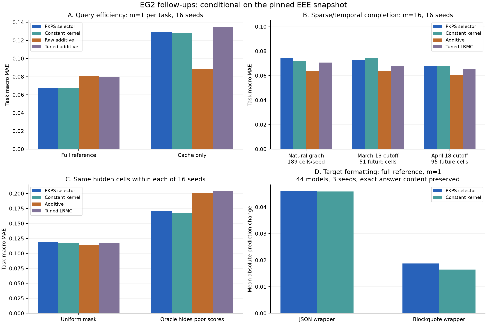

# PKPS stress-test audit and EEE revision plan

Audit date: 2026-10-12. Code reviewed at commit
`4097f3a3b95020504eed50ea2ff602a9e1df2029`.

## Summary for coauthors

**Decision: narrow the claim to what response features contribute under explicitly
stated reference-score access.** These EEE experiments do not establish an added
benefit from query similarity or general robustness to selective reporting. The
additive query baseline, natural incomplete graph, temporal holdouts, and controlled
formatting interventions have now been tested with **EmbeddingGemma-2 (EG2)**.
EG2 is the accepted encoder for this revision; the measurements below describe
the corrected follow-up pipeline, separately from the historical paper results.

- **The query kernel has no demonstrated predictive advantage here.** At one
  response per task, full-reference MAE is **0.0674** for the expanded PKPS selector
  and **0.0672** for the constant kernel. The selector chooses constant in
  **350/624** full-reference folds across budgets. All 12 original constant/shuffle
  comparisons have intervals containing zero; this is absence of demonstrated
  benefit, not proof of equivalence.
- **The missing additive baseline does not explain away the full-reference
  result, but wins in cache-only query prediction.** At the same m=1 budget
  (**16 responses per model**), nested additive MAE is **0.0794**, versus PKPS
  **0.0674** with other developers' full scores. With only cached sample scores,
  fixed raw additive reaches **0.0880**, versus PKPS **0.1290** and fixed
  sample/task-mean shrinkage **0.1146**. Cache-only nested additive selection itself
  fails at m=1 (**0.1352**); the fixed and tuned results must both be reported.
- **Score-only completion remains a strong baseline under the new checks.**
  Additive beats PKPS on the naturally incomplete graph (**0.0636 vs 0.0743**) and
  both evaluation-time holdouts (**0.0638 vs 0.0731**, **0.0602 vs 0.0679**).
  All three paired advantages survive correction across the 12 sparse-completion
  contrasts. Natural-graph evaluation hides known outcomes; the 157 genuinely
  absent outcomes remain unscorable. Temporal results cover only 51 and 95 future
  cells with earlier model/task support.
- **Selective-reporting protection survives only as a narrower finding.** In
  the repeated oracle poor-score-hiding probe, PKPS beats additive and LRMC on
  matched hidden cells (**0.1713 vs 0.2007 and 0.2045**), across 16 seeds. Constant
  is **0.1672**. This supports response features under that particular mask, not
  an advantage from query similarity or a general real-cache robustness claim.
- **Cache composition and formatting affect the representation.** The earlier
  task-mix probe moves models by about **0.90×** typical between-model distance
  for median-bandwidth RBF, versus **0.61×** for constant. In a new, exactly
  reversible JSON-formatting intervention, PKPS full-reference MAE rises from
  **0.0682 to 0.0832** with answer content and scores fixed. This style check uses
  44 eligible models and three seeds; blockquote formatting has a much smaller
  effect. It does not test every prose style.
- **The geometry repair is valid; replacement statistical theory is unfinished.**
  Model-wise query-mass normalization gives a PSD affinity for PSD kernels with
  positive self-masses. It does not establish concentration or strict prediction
  improvement. The guarded-selector statement also requires a guard that ordinary
  nested MAE selection does not implement.

The manuscript still needs the raw-stress/MDS correction, reference-label and
ensemble-leakage corrections, observed-only preprocessing, actual bandwidth/cohort
grids, and matched IRT coverage; EEE scores are not all binary. The response-pool
count is now reconciled: **30,304 rows across 69 models**, versus **23,040** in the
complete 45-model cohort. The new checks use 16 seeds except formatting (three).
Intervals describe randomized runs conditional on this frozen dataset, not new
model populations. **62 tests pass.**

See the [completed checks and their limits](#completed-additional-eg2-checks),
[result figure](artifacts/stress-test/next-checks/overview.pdf), and
[verification record](artifacts/stress-test/next-checks/verification.json).

This document records mathematical repairs, implementation findings, proposed
manuscript changes, and local follow-up experiments for *Predicting Benchmark Scores
from Sparse and Unpaired Cached Responses*. Completed checks and measurements are
distinguished from proposed changes; the historical paper results are not replaced
by measurements from a different embedding model.

The review considered the supplied `Stress Test Claims.pdf` and
`pkps_mathematical_checks.py` as evidence to assess, not instructions to execute.
The mathematical examples were independently recomputed. The examples below make
the main findings reproducible without those external attachments.

## Status and scope

| Work | Status |
| --- | --- |
| Read the manuscript and trace the relevant code paths | Completed |
| Independently reproduce the negative-distance and raw-stress examples | Completed; values and reproduction below |
| Demonstrate the ensemble's indirect full-score dependency | Completed in an isolated numerical example; benchmark impact unmeasured |
| Propose a positive-semidefinite affinity and consistent MDS definition | Implemented and tested in the separate follow-up drivers; revised statistical proofs pending |
| Modify estimators, preprocessing, validation, or manuscript | Corrected follow-up pipeline implemented; original package defaults and manuscript unchanged |
| Add EmbeddingGemma-2 support and test it on a Mac | Completed: MPS float32 and bfloat16 verified against CPU; float32 selected |
| Download EEE, regenerate embeddings, and run benchmark follow-ups | Completed: original 48 query and 64 completion runs; additional additive, natural-graph, temporal, formatting, and 16-seed selective-reporting checks below |

Initial audit used standard-library reproductions. Subsequently the supplied NumPy
checks were executed in the existing `py314` conda environment. Because this package
requires Python <3.13, the installed conda distribution was used to create the
project-local `.conda-eee` Python 3.12 environment. The unchanged package baseline
passed **29 tests** (three warnings). The expanded suite now passes **62 tests**
(three existing warnings). Archived paper CSVs remain historical results; the
separate EG2 artifacts report executed follow-ups under the corrected pipeline.

### Reference PDF and evidence

The user-supplied `pkps_iclr (1).pdf` (21 pages) is the authoritative reference for
this audit. SHA256:
`74c4f64cca84fcb5eb0c84479305dab909929d7574779bad0ab738be063034c6`.
Its Table 1 agrees with the corresponding table in `writing/main.tex`. Page numbers
below are PDF page numbers, also matching the printed page numbers.

| Paper location | Verification and implication |
| --- | --- |
| p. 3, Eq. 1, lines 143–149 | Pair-specific query-mass normalization is the construction disproved by the negative-distance example. The later Euclidean assumption makes the theory conditional; it does not establish that Eq. 1 satisfies the assumption. |
| p. 3, Eq. 2, lines 151–161 | The raw-stress/classical-MDS equivalence is asserted even for dimension reduction. The rectangle counterexample directly contradicts that assertion. |
| p. 14, lines 731–745 | Observed-only PCA, a near-delta candidate in bandwidth CV, and d=8 are specified. The audited driver fits preprocessing before masks and does not include its near-delta embedding among CV candidates. |
| p. 14, lines 747–755 | The claimed common logit/standardization/bias pipeline differs from the raw-score query-efficiency driver. |
| p. 15, lines 763–767 | The assertion that no predicted family's full scores enter the ensemble requires nested predictions; deleting validation rows alone is insufficient. |
| p. 15, lines 769–794 | Published sweeps use 16 seeds and Gemini embeddings. New EmbeddingGemma pilot measurements must be identified separately. |

Rendered evidence (from the supplied PDF, using `pdftoppm -r 100 -png`):


The [preprocessing/regression page](artifacts/stress-test/paper-14.png) and
[ensemble/evaluation page](artifacts/stress-test/paper-15.png) are retained too.

### Local execution record

- Dataset: `evaleval/EEE_datastore`, revision
  `8b9632422dd2b3806431efd758c7cdc84044169f`; latest manifest `added_at` per
  model/benchmark, restricted to the intersection of the five named collections.
- Downloaded and checksum-verified **225 runs, 45 models, 16 tasks** in
  `/Users/avijit/Documents/EEE Datastore`. Full-depth targets were calculated before
  sampling. A deterministic cap of 32 yields **23,040 response rows and 6,774 unique
  query IDs**. Extending to all 69 models yields **30,304 response rows**, reconciling
  the paper's response-pool count (p. 15): embeddings are pooled before the loader
  restricts to complete models. The new deterministic sampling gives 7,617 unique
  queries in that larger pool, versus the paper's 7,665, so this is not an exact
  recreation of its query sample.
- Provenance, full-depth targets, and pooled rows are under `data/eee-followups/`;
  large raw data/model weights remain ignored by Git. The sampling and download
  implementation is [prepare_eee_followups.py](scripts/data/prepare_eee_followups.py).
- Hardware: Apple M5, 10 GPU cores, Metal 4; macOS 27.0.1. PyTorch 2.14.1 reports
  `is_built=True`, `is_available=True` outside the execution sandbox. A sandboxed
  probe reports unavailable; this is a process-access limitation, not missing M5
  support. Use `device='mps'` and fail explicitly if unavailable.
- Model: `google/embeddinggemma-2`, revision
  `914f7f89142e33e77833254d9c9b90c3cef7303b`, downloaded locally. The
  [new adapter](scripts/data/embed_eee_followups.py) disables vision/audio encoders,
  uses the same symmetric prompt for query and response embeddings, and writes
  resumable shards. CPU fallback is disabled during GPU measurements. The processor
  still requires Pillow and torchvision even with unused encoders disabled.

### Check against the reported EEE results

The [Table 1 comparison](artifacts/stress-test/paper_table1_eee_check.csv) recomputes
archived CSV summaries using the paper's order: mean over reported tasks within
each seed, then mean over seeds. This checks reporting consistency, not independent
replication. The important EEE points are:

| Setting | Sample / LRMC | PKPS | Ensemble |
| --- | ---: | ---: | ---: |
| Query efficiency m=1 | 0.223843 | 0.070025 | 0.067784 |
| Query efficiency m=8 | 0.081330 | 0.059524 | 0.049769 |
| Completion n=10, coverage=0.5 | 0.108820 | 0.080790 | 0.080798 |
| Completion n=45, coverage=0.5 | 0.095749 | 0.070436 | 0.069033 |
| Completion n=10, coverage=0.2 | 0.144232 | 0.108118 | 0.107764 |

These round to the corresponding entries in the supplied PDF. Among the other
entries, DKPS at m=8 is **0.07749555** in the CSV, which rounds directly to 0.077,
while the paper prints 0.078. Double rounding could explain the tiny difference,
but that provenance has not been established; regenerate directly from the saved
unrounded summaries.

IRT at m=1 is 0.164993 **only under the reported-task/seed aggregation**: it has
finite error on just **2–7 of the 16 tasks per seed** (7 tasks at m=8).
[Per-seed coverage](artifacts/stress-test/archival_task_coverage.csv) is recorded.
Its table error therefore does not represent the same supported task set as the
other methods. Add coverage and a matched-task comparison before interpreting
that number as an across-method ranking.

The [matched-task recomputation](artifacts/stress-test/archival_matched_irt_tasks.csv)
gives, at m=1, sample **0.150186**, IRT **0.164993**, DKPS **0.101646**, PKPS
**0.054057**, and ensemble **0.051556**. In particular, IRT does not outperform the
sample baseline on its own supported tasks, despite that apparent ordering in the
unmatched Table 1 entries. This is a concrete reporting correction based on the
paper's existing results, independent of the new embedding experiment.

## 1. Repair the affinity and embedding definition

### Finding: pair-specific normalization can produce negative squared distances

For the RBF query kernel with bandwidth 1 and linear response kernel, use query
coordinates `[-1, 1]` for one model and `[-2, 2]` for another. Each model's two
response vectors are `(1, 0)` and `(0, 1)`. The paper's ratio affinity gives

```text
A = [[0.880797077978, 0.982013790038],
     [0.982013790038, 0.999664649870]]
D12^2 = -0.0835658522284
negative centered-Gram eigenvalue = -0.0417829261142
```

This disproves a general geometric guarantee for that normalization. It does not
disprove a theorem explicitly conditional on Euclidean distances.

Both `ProductKernelPerspectiveSpace.fit` / `dist_matrices` in
[unpaired_dkps.py](../../dkps/unpaired_dkps.py) and `PKPS._dist_matrix` in
[pkps.py](../../dkps/pkps.py) clamp negative squared distances to zero. Clamping
allows a square root but does not ensure a Euclidean distance matrix. Diagnostics
must inspect the raw values before that information is lost.

### Proposed main construction: normalize separately by model

Define

$$
S_{ij}=\sum_{a\in Q_i}\sum_{b\in Q_j}
k_Q(u_a,u_b)k_R(x_{ia},x_{jb}),\qquad
Z_{ij}=\sum_{a\in Q_i}\sum_{b\in Q_j}k_Q(u_a,u_b).
$$

Replace the original $A_{ij}=S_{ij}/Z_{ij}$ with

$$
\widetilde A_{ij}=\frac{S_{ij}}{\sqrt{Z_{ii}Z_{jj}}}.
$$

Require positive-semidefinite query and response kernels and $Z_{ii}>0$. RBF query
kernels satisfy the latter for nonempty caches. A linear response kernel is
positive semidefinite even though individual kernel values can be negative;
the manuscript should not require its codomain to be nonnegative.

To see the geometric guarantee, let $\phi_Q$ and $\phi_R$ be kernel feature maps and
define

$$
v_i=\frac{\sum_{a\in Q_i}\phi_Q(u_a)\otimes\phi_R(x_{ia})}
{\sqrt{Z_{ii}}}.
$$

Then $\widetilde A_{ij}=\langle v_i,v_j\rangle$, so $\widetilde A$ is positive
semidefinite and

$$
D_{ij}^2=\widetilde A_{ii}+\widetilde A_{jj}-2\widetilde A_{ij}
=\|v_i-v_j\|^2\ge0.
$$

This construction agrees with the original affinity when all models have the same
query set, with matching multiplicities. The delta query kernel on a common query
set recovers paired DKPS. With $k_Q\equiv1$ and a linear response kernel, it gives
the inner products of mean response embeddings, including unequal cache sizes.

This is a changed estimator and population estimand. Its statistical guarantees
and empirical performance must be established anew. In particular, it does not
remove dependence on task mix, difficulty, or other query-design differences.
At zero exact overlap its delta-kernel version is defined, but is not the same
procedure as the original undefined-distance fallback.

### Replace raw stress with the spectral objective actually used

The current `eq:mds` in [main.tex](writing/main.tex) defines a raw-stress minimizer
and then identifies it with classical MDS. These differ under dimension reduction.
For a 2-by-1 rectangle reduced to one dimension:

```text
Classical coordinates: [-1, 1, -1, 1]
Alternative coordinates: [-1.1, 0.9, -0.9, 1.1]
Classical raw stress:   4.222912360003
Alternative raw stress: 2.942912360003
```

Use a consistent spectral definition instead:

$$
J=I-\frac1n\mathbf1\mathbf1^\top,\qquad
B=J\widetilde A J,\qquad
\widehat\Psi=U_d\Lambda_d^{1/2}.
$$

Here $U_d$ contains eigenvectors for the largest positive eigenvalues, retaining
at most $d$ of them. This produces a best rank-at-most-$d$ positive-semidefinite
approximation of $B$ in Frobenius norm. It need not minimize raw distance stress.
If numerical rank is below $d$, use the available positive directions; handle a
zero-rank result explicitly. Only tolerance-sized negative values may be treated
as roundoff after the PSD construction.

Use a symmetric eigendecomposition with explicit signed-eigenvalue handling.
Do not assume the installed `ClassicalMDS` implementation has the intended behavior
on indefinite input, or substitute absolute eigenvalues for positive eigenvalues.

Keep the original ratio affinity with explicit positive-part projection of $JAJ$
as a comparison. For this comparison, form $JAJ$ directly before distance clipping.
Projection changes the geometry and must be reported as part of the estimator.

## 2. Align the theory with the estimator and information budget

The labels below refer to [the manuscript source](writing/main.tex).

| Claim or proof component | Required revision |
| --- | --- |
| `thm:qeff`, noninferiority | State a guarantee for a guarded selector that contains the baseline. Ordinary CV and an arbitrary nonzero bandwidth do not inherit it. |
| `def:qeff`, strict fixed-budget improvement | Remove this conclusion unless a new proof establishes it. The current strict-improvement argument lets query budgets grow. State explicit joint conditions on model count, budget, and spectral gap. |
| `lem:noisy`, averaging neighbor score noise | Neighbor selection depends on the responses used to estimate scores. Establish conditional mean-zero noise using independently sampled labels, or analyze the selection dependence. |
| Validation against true scores | Specify exact reference labels, or prove the result for available noisy labels. Under suitable conditional independence, squared-loss noise contributes a candidate-independent term; this does not automatically hold for MAE. |
| `lem:conc`, diagonal affinities | Self-affinities reuse one sample and contain diagonal terms. Treat them as within-sample V-statistics and account for bias/dependence. The two-independent-samples argument is insufficient for them. |
| Preprocessing and spectral concentration | Specify fixed or separately fitted feature maps, the revised population affinity, and relevant positive-eigenvalue gaps. Do not silently carry the original constants to the new normalization. |
| Comparison at zero pairing | Identify the exact baseline and its fallback. Failure of a method discarding unmatched responses is not a lower bound for every sparse-data estimator. |

If sample splitting is used, count feature, label, and validation responses in the
budget. Disjoint subsets of a fixed finite benchmark are not automatically
conditionally independent; justify the sampling design rather than invoking
splitting alone. Developer-related models also need a dependence-aware validation
analysis rather than being counted as independent validation units.

A possible fixed-budget analysis would target residual risk such as
$\mathbb E[\operatorname{Var}(Y\mid C_m)]$, where $C_m$ is the permitted cache or a
fixed representation of it. More reference models cannot generally eliminate
uncertainty absent from a fixed target cache. This is a direction for new theory,
not an established result for the current jointly fitted MDS estimator.

### A valid guarded-selector statement to replace the unconditional claim

One limited replacement can be proved without assuming that ordinary CV is a
guard. Freeze a baseline $h_0$ and $K$ candidate predictors before observing an
independent validation set of $N$ i.i.d. evaluation units. Predictions and labels
are in $[0,1]$. Let $\widehat\Delta_k$ be the mean validation difference in squared
loss, candidate minus baseline, and set

$$
\epsilon_N=\sqrt{\frac{2\log(K/\delta)}{N}}.
$$

Choose a candidate only if $\widehat\Delta_k+\epsilon_N\le0$; otherwise retain
$h_0$. Each loss difference lies in $[-1,1]$. One-sided Hoeffding plus a union
bound yields $\Delta_k\le\widehat\Delta_k+\epsilon_N$ simultaneously for all $K$
candidates with probability at least $1-\delta$. Thus, on that event, the selected
predictor's population squared risk is no worse than the baseline's.

This establishes **high-probability guarded noninferiority under explicit
validation assumptions**, not strict improvement, an unconditional expected-risk
ordering, or a property of the current CV implementation. Strict improvement
requires a candidate with a sufficient risk margin and enough validation data.
The validation units cannot be correlated cells counted as independent models.
If noisy labels replace true scores, the expected squared-loss difference is
preserved only with the required conditional zero-mean noise relative to both
predictors; reusing the same response-derived label can violate that condition.
All extra validation observations must be counted. The local pilot below uses
ordinary nested MAE selection and therefore does **not** claim this theorem.

## 3. Implementation findings and required changes

| Finding | Evidence in code | Change |
| --- | --- | --- |
| Query efficiency regresses on full reference scores | `_regress` passes `score_mat` to `_lofo_regress` in [query_efficiency.py](scripts/experiments/query_efficiency.py) | Add explicit full-reference and cache-only regimes; keep evaluation targets separate. |
| Completion uses sampled observed scores | `trial` constructs `samp` and fits predictors to it in [completion.py](scripts/experiments/completion.py) | Describe this information regime separately from query efficiency. Record scoring depth and embedding depth, which can differ. |
| PCA is fitted before observation masks | `load_eee` reduces the entire response pool and query collection in [loaders.py](scripts/pipeline/loaders.py); drivers subsequently subset them | Load frozen unreduced embeddings first, apply masks, then fit PCA, dimension selection, and bandwidth scales on permitted data. |
| Outer-family scores can indirectly influence ensemble weights | `run_seed` reuses `pk_mat` across all outer families; [Ensemble._learn](../../dkps/ensemble.py) has the analogous structure | Regenerate inner predictions within each outer split, excluding outer-family full scores from every inner training set. |
| Near-delta baseline is absent from the actual CV candidate dictionary | `Ds` includes `SIG_DELTA`, but `Zs` contains only `SIG_GRID` in `run_seed` | If claiming guarded selection against DKPS, include the actual baseline and implement the guard. Small RBF bandwidth is not exact ID matching. |
| Claimed disjoint sampling can reuse queries | `run_seed(disjoint=True)` falls back to `idx` when no unused query is available | Enforce feasibility, fail or adjust the design, and report actual overlap and counts. |
| Query-efficiency regression differs from the common pipeline described in the appendix | `_lofo_regress` in [query_select.py](scripts/pipeline/query_select.py) fits raw-score kNN or OLS | Describe the actual protocol and match it across controls, or explicitly change and rerun the pipeline. |

The full-reference regime is legitimate. Its use is not itself leakage: a new
target can be predicted from historical reference scores. It does not establish
performance when every reference label also comes from a tiny cache.

### Why the ensemble needs nested predictions

For an outer held-out family $F$, the ensemble chooses its blend weight using
predictions for other families $G$. Those predictions exclude $G$ but can have
been trained on $F$'s full scores. Excluding $F$ only from the final validation
rows does not remove this path:

```text
outer family's full scores
    -> predictions for other families
    -> selected ensemble weight
    -> outer family's ensemble prediction
```

An isolated example using nine models, three families, distance-weighted 5-NN,
and the existing 21-point weight grid gives:

| Quantity for the first target | Original full scores | Only outer-family full scores inverted |
| --- | ---: | ---: |
| Base prediction | 0.380605320874 | 0.380605320874 |
| Weight on own sample | 0.65 | 0.75 |
| Ensemble prediction | 0.133211862306 | 0.095151330219 |

The example demonstrates the dependency with fixed coordinates and sampled
scores. It is not an execution of the complete benchmark pipeline and does not
estimate the size of bias in the reported table. A test on one dataset or one
perturbation can also pass when a discrete selected weight happens not to change.

For each outer family, remove its forbidden full scores first. Generate inner
validation predictions using only remaining families, choose all supervised
hyperparameters and ensemble weights, then fit on those references and predict
the outer targets. Permitted target cache responses and scores may remain
available as specified by the protocol; full target scores may not.

For completion, inner validation must remove the validation cells' responses
as well as scores. Leaving their response-derived features in the representation
validates a different, easier task. Refit affected preprocessing and geometry.

## 4. EEE follow-up design

### Freeze the data and information regimes

Start with `math-mc`, `gsm-mc`, `gpqa-diamond`, `judgebench`, and `reward-bench-2`.
The manuscript cohort has 45 models and 16 tasks; a fresh datastore revision need
not produce that cohort. Save the chosen model/task/run lists rather than assuming
the current store reproduces those counts.

Use the full instance-level companion files and pin the dataset revision. EEE's
documented `load_dataset(..., split="sample")` configurations expose viewer
samples, not complete collections. The [EEE dataset documentation](https://huggingface.co/datasets/evaleval/EEE_datastore)
describes revision-pinned downloads and immutable flat snapshots.

Preserve benchmark version, metric, run configuration, and provenance. Namespace
query IDs by benchmark/version and verify that an ID identifies consistent query
text. Select one compatible run per model/benchmark using a recorded rule;
filesystem modification times are not adequate provenance. Use the score parsing
in [dkps.eee](../../dkps/eee.py), including its handling of string scores. The
existing fetch helper resolves `main`; add revision support and separate caches
by revision before using it for this study.

| Regime | Reference information | Target information | Full evaluation targets |
| --- | --- | --- | --- |
| Full-reference | Budgeted response features plus full reference aggregate scores | Budgeted responses and permitted per-item scores | Outer family's full scores reserved for assessment |
| Cache-only | Observed responses and their scores only | Same observation policy | Full scores reserved for assessment everywhere |

Specify whether any baseline receives full reference **item-level** scores in
addition to aggregate scores. Do not give an IRT or other baseline an undocumented
information advantage or disadvantage. In cache-only tuning, any additional
validation item scores must count toward the declared budget; at $m=1$ they cannot
be introduced silently. Validation MAE against noisy labels is a different target
from MAE against full scores and must be described accordingly.

Build full-depth targets before the 32-query pool cap. Treat them as finite-run
reference measurements, not noise-free universal model capabilities. Keep the
truth table outside predictor inputs. Apply one observation mask to both response
and score access, and restrict learned preprocessing to allowed rows.

Frozen per-text embeddings can be computed and cached before experimental masks;
they have no fitted dependence on other rows. The training process must not access
hidden vectors or fit PCA on them. For a strict inductive protocol, fit reducers
and the reference geometry on training references and transform new models out of
sample. If a transductive protocol includes permitted target features in fitting,
label it explicitly and do not claim it implements the inductive guarded theorem.

### Experiment matrix

| ID | Comparison | Held fixed | Main question |
| --- | --- | --- | --- |
| E1 | Historical clipping pipeline; original affinity with PSD projection; proposed model-wise normalization | Embeddings, masks, regressor, score access | Does the geometric repair alter prediction quality? |
| E2 | Full-reference versus cache-only | Cohort, response masks, outer folds | Which score-access regime supports the gains? |
| E3 | RBF, exact delta, constant query kernel, task-only kernel, shuffled query embeddings | Normalization, regression, preprocessing, permitted labels | Does query semantics help beyond response means or task membership? |
| E4 | Sample mean, task mean/median, shrinkage, additive model/task bias, tuned LRMC, sparse Rasch, mean-response embeddings | Information access, outer splits, tuning opportunity | What remains beyond strong simple baselines? |
| E5 | Same underlying model with altered task mix, query difficulty, and available response-style variants | Model identity and total response budget | How much does cache design move representations and scores? |
| E6 | Uniform, specialist-biased, poor-score-hiding masks; temporal/developer holdouts; natural sparse caches | Declared budget and observable-information rules | Does performance extend beyond uniform induced missingness? |

For E3, permute query embeddings among unique IDs within each task and apply one
shared permutation to all occurrences of an ID. This preserves task membership
and exact matches while breaking semantic neighborhoods. A separate independent
per-model shuffle can probe correspondence destruction, but answers a different
question. Include both pooled mean response embeddings and task-balanced means;
specify how the latter handle absent tasks without using hidden responses.

Tune LRMC rank and regularization on inner splits. Fit sparse Rasch on observed
edges rather than requiring a dense rectangle; report connectivity and
identifiability limitations. Evaluate methods on matched supported cells and
report coverage/failures, so a baseline cannot improve its apparent error merely
by abstaining on difficult cells. Include a small deliberately shared-query
design at a matched total budget where feasible.

For E5, compare pairwise geometry or align embeddings before comparing coordinates
because MDS orientation is arbitrary. Synthetic score-dependent masks in E6 may
use truth only in a separate mask generator, never in the learner. Natural missing
cells have no evaluation truth: assess them through later observed outcomes or
held-out known runs, and acknowledge remaining selection bias. Use genuine
availability timestamps for temporal evaluation, not upload order as a proxy for
model release without verification.

### Budgets, diagnostics, and reporting

Start with three masking seeds and $m\in\{1,4,8\}$ at full task coverage. For
completion, start with coverage $p\in\{0.2,0.5\}$ and cohorts of 10 and the full
frozen cohort. Use identical masks across methods. Expand the planned final
comparisons to 16 seeds once correctness checks pass. Report both per-task and
total target budgets: 16 tasks at $m=1$ means 16 responses, not one total response.
Account separately for historical reference labels and any additional validation
queries. Define completion depth relative to the capped pool or full benchmark
explicitly; the existing driver operates on its available pool.

Record raw negative-distance frequency/minimum, negative Gram eigenvalue mass,
projection distortion, spectral rank, query mass, actual overlap, and zero-mass
fallbacks. For pair-weight concentration, $(\sum w)^2/\sum w^2$ is a useful
descriptive diagnostic, but its pairs share queries and are not independent
observations. Strict positivity of an RBF is not evidence of useful overlap.

Report macro task/benchmark MAE, MSE for comparison to the theory, tail errors,
ranking inversions, and directional threshold errors. Save per-cell predictions.
Use paired method differences with benchmark- and developer-aware uncertainty;
masking seeds are repeated measurements of the same cohort. Report individual
benchmark results and sensitivity to removing each benchmark, since five
benchmarks provide limited evidence for generalization across domains.

Calibrate prediction intervals on separate allowed data, report empirical coverage
and width, and evaluate an overlap/uncertainty-based abstention policy. Do not
promise distribution-free coverage under arbitrary developer or temporal shift.
Label predicted benchmark entries as imputed and preserve their provenance.

## 5. Verified M5 setup and runnable local follow-ups

The original checkpoint runs directly through PyTorch's Metal backend (`mps`);
no MLX conversion or quantized checkpoint is required. Both float32 and bfloat16
were tested with 16 real EEE responses, batch size 8, after a warm-up:

| Backend | Elapsed time | Texts/s | Minimum cosine with MPS float32 |
| --- | ---: | ---: | ---: |
| CPU float32 | 3.038 s | 5.27 | 0.99999994 |
| M5 MPS float32 | 1.236 s | 12.95 | 1 |
| M5 MPS bfloat16 | 1.260 s | 12.70 | 0.999946 |

These are small-sample measurements, not a sustained-throughput guarantee. Float32
was chosen for the actual cache: bfloat16 did not improve this smoke-test time and
introduced a maximum component difference of 0.00228. Float32 GPU/CPU maximum
component difference was 3.58e-7. CPU fallback was disabled. Both configurations
produced finite normalized 768-dimensional embeddings. The adapter renormalizes
in float32 after encoding to avoid storing bfloat16 norm-rounding error.


[Raw smoke-test measurements](artifacts/stress-test/mps_smoke_test.json) and
[resolved environment](artifacts/stress-test/environment.txt) are committed evidence.
The latter is an environment inventory, not a portable requirements file (it
contains conda build paths and an editable checkout).

Google's [model card](https://huggingface.co/google/embeddinggemma-2) specifies
selective encoder loading, symmetric similarity prompts, and float32 or bfloat16;
**float16 is unsupported**. The pinned checkpoint's Sentence Transformers config
requires version 6.1+. This run uses Python 3.12.15, torch 2.14.1, transformers
5.19.0, sentence-transformers 6.1.0, Pillow 12.3.0, and torchvision 0.29.1.
The existing conda installation created `.conda-eee` because the user's `py314`
environment cannot satisfy this repository's Python <3.13 requirement.

```bash
# Reproduce setup using the existing conda installation (already done here).
/opt/miniconda3/bin/conda create --prefix "$PWD/.conda-eee" \
  --override-channels -c https://repo.anaconda.com/pkgs/main python=3.12 pip -y
.conda-eee/bin/python -m pip install -e . \
  'sentence-transformers==6.1.0' 'transformers==5.19.0' 'torch==2.14.1' \
  'torchvision==0.29.1' pillow huggingface_hub pyarrow python-dotenv rich pytest matplotlib

# Download the immutable model snapshot once.
HF_HUB_DISABLE_XET=1 .conda-eee/bin/hf download google/embeddinggemma-2 \
  --revision 914f7f89142e33e77833254d9c9b90c3cef7303b \
  --local-dir data/models/embeddinggemma-2 --exclude '*.onnx' --exclude '*.tflite'

# Full-depth targets are prepared before applying the 32-query pool cap.
.conda-eee/bin/python projects/pkps/scripts/data/prepare_eee_followups.py \
  --source '/Users/avijit/Documents/EEE Datastore' --download

# Run in a normal Terminal process with Metal access; the agent sandbox hides MPS.
.conda-eee/bin/python projects/pkps/scripts/data/embed_eee_followups.py --smoke
.conda-eee/bin/python projects/pkps/scripts/data/embed_eee_followups.py \
  --device mps --dtype float32 --batch-size 8 --max-length 2048

.conda-eee/bin/python -m pytest tests -q
.conda-eee/bin/python projects/pkps/scripts/experiments/stress_followups.py \
  --budgets 1 4 8 --seeds 0 1 2
.conda-eee/bin/python projects/pkps/scripts/experiments/stress_completion.py \
  --cohorts 10 45 --coverage 0.2 0.5 --m 16 --seeds 0 1 2
MPLCONFIGDIR=/tmp/pkps-mpl .conda-eee/bin/python \
  projects/pkps/scripts/experiments/report_stress_followups.py
```

The separate follow-up drivers preserve the historical drivers and results.
Each embedding cache records revision, prompt, dtype, dimensions, truncation,
ordered-text hash, timings and dependencies, and can resume completed shards.
Changing those parameters requires a separate cache. All methods use the same
frozen encoder and observation masks. The pilot uses a **2,048-token limit**,
not the model's 8K maximum or the original script's 8,000-character truncation.
It uses full 768-dimensional unit vectors with no learned PCA; response/query
preprocessing therefore cannot fit hidden rows. These differences, as well as
changed tuning, prevent interpreting the pilot as an exact Table 1 reproduction.

The first long run reached Metal's allocation limit after approximately 10,000
saved texts (the error reported 3.52 GiB allocated by MPS and 38.51 GiB of other
allocations). The adapter now releases unused Metal allocations between shards
and retries memory failures with smaller batches, recording actual batch sizes.
It resumes existing shards and keeps the default GPU memory safety limit enabled.
The 2,048-token cap was independently checked on a 5,000-word tokenizer input.

The query-efficiency runner compares original ratio plus historical clipping/SVD,
original ratio plus signed PSD projection, and model normalization. It tunes each
RBF method on the same five bandwidth multipliers inside outer developer folds.
Controls are constant, exact delta, task-only, and shared within-task query shuffle.
An expanded model-normalized selector explicitly includes constant and delta.
All embedding methods use raw-score distance-weighted 5-NN, matching the audited
query-efficiency code rather than claiming to implement the appendix's logit
pipeline. Observed target features enter a transductive geometry, explicitly.

Full-reference training and validation receive only other developers' full scores.
Cache-only learning receives no full-score table. Tuning a sample/prior blend
against those same sample means would trivially favor the sample itself; therefore
cache-only uses a declared fixed 50:50 blend, while full-reference uses nested
21-point weight selection. No independent-label guarantee is claimed for noisy
cache-only bandwidth selection. Both regimes include task mean/median, own sample,
and fixed sample/task-mean shrinkage controls.

Completion uses observed sample scores only. Inner validation removes both scores
and response rows for 20% of observed cells, preserving at least one observed cell
per model/task. It recomputes the geometry and score preprocessing. Logit transform,
per-task standardization, and two-way additive bias are shared by perspective and
LRMC predictors. LRMC rank {1,2,4} and ridge {0.1,1} are tuned on the same inner
cells (five initializations); the PKPS/LRMC ensemble also uses that inner split.
Zero-reference residual predictions fall back to the additive estimate, with
fallback frequency reported. At m=16, depth is half of the 32-query pool, not half
the original benchmark. Minimum-coverage conditioning changes realized coverage;
run manifests report actual counts and masks.

### Completed additional EG2 checks

All results below were executed on the pinned EEE snapshot with the same EG2
checkpoint, symmetric prompt, MPS float32, normalized 768-dimensional vectors,
and no learned PCA. The original 28,590 cached vectors were preserved exactly;
only additional texts were encoded. MAE averages models within each evaluated
task, then tasks within each seed, then seeds. `PKPS` below means the
model-normalized expanded selector, whose candidates include constant and delta.
The original [query results](artifacts/stress-test/query_summary.csv),
[kernel selections](artifacts/stress-test/query_selection_counts.csv), and
[uncertainty audit](artifacts/stress-test/uncertainty-audit/paired_run_intervals.csv)
remain available for the earlier findings in the opening summary.



**Additive query efficiency: 45 models, 16 tasks, 16 matched seeds.** The new
score-only predictor estimates task means from permitted reference labels and
target strength from its sample scores on the **other 15 tasks**. It never uses
the predicted task's sample score to estimate strength. Fixed raw, fixed
logit/standardized, and nested MAE selection over both scales and five strengths
are reported. Outer developer full scores are absent from full-reference inputs;
cache-only receives no full-score table. Sample-score matrices match the archived
EG2 runs exactly. Budgets m=1,4,8 mean 16,64,128 responses per model.

| Regime / method | m=1 | m=4 | m=8 |
| --- | ---: | ---: | ---: |
| Full-reference PKPS | 0.067434 | 0.060550 | 0.059072 |
| Full-reference raw additive | 0.080922 | 0.063298 | 0.060903 |
| Full-reference logit additive | 0.126649 | 0.102590 | 0.081982 |
| Full-reference nested additive | 0.079430 | 0.063595 | 0.060903 |
| Cache-only PKPS | 0.128981 | 0.085126 | 0.073165 |
| Cache-only raw additive | 0.088003 | 0.066489 | 0.062464 |
| Cache-only logit additive | 0.136387 | 0.115558 | 0.091515 |
| Cache-only nested additive | 0.135153 | 0.076998 | 0.062464 |

At m=1, full-reference PKPS minus nested additive is **−0.011996** with a
Bonferroni-adjusted 95% interval **[−0.021128, −0.002865]** across 18 contrasts.
Cache-only PKPS minus fixed raw additive is **+0.040977 [0.036564, 0.045391]**.
The raw additive advantage over standalone cache-only PKPS holds at all three
budgets, but it does not beat every response-based predictor: the existing fixed
ensemble has MAE **0.053864** at m=8. Cache-only nested selection often chooses the
poor logit variant at m=1; selecting against noisy sample-label MAE does not ensure
good full-depth MAE. At m=4 and m=8, the small full-reference PKPS advantages over
raw additive have adjusted intervals containing zero.
[All additive results](artifacts/stress-test/next-checks/additive_summary.csv),
[paired intervals](artifacts/stress-test/next-checks/additive_paired_intervals.csv),
and [selections](artifacts/stress-test/next-checks/additive_selection.csv) are saved.

**Natural incomplete graph and temporal holdouts: 16 seeds, m=16 per observed
cell.** The extended snapshot contains **307 selected runs, 69 models, 16 tasks,
947 known cells, and 157 naturally absent cells**. Twenty-four models are outside
the original complete cohort. All 947 full-depth targets match their aggregate
companions to numerical precision. For the natural-graph check, hide 189 known
cells per seed, preserving row/column support, and learn only from the remaining
758 cells. Both response rows and scores for held-out cells are excluded, including
inside tuning. Actual absent outcomes are not filled with fabricated ground truth.

Temporal cutoffs are the 60th and 80th percentiles of the ordered **evaluation
timestamps** of selected runs: **2026-03-13 16:12:32 UTC** and
**2026-04-18 09:07:34 UTC**. Only earlier response rows and sample scores enter
learning. Of 288 and 164 later known cells, respectively, **51 and 95** have
earlier support for both their model and task. They cover 11 models/14 tasks and
33 models/16 tasks. Earlier training has 659 and 783 cells. The first split
excludes 237 cells with missing model/task support; the second excludes 69.
These are retrospective splits of the selected-run snapshot, not verified
public-availability or model-release simulations. Sixteen seeds vary response
sampling and inner validation, not the temporal cutoffs or future target sets.

| Design | Additive | PKPS | Constant | Shuffled RBF | Tuned LRMC | Nested ensemble |
| --- | ---: | ---: | ---: | ---: | ---: | ---: |
| Natural graph | 0.063565 | 0.074323 | 0.072249 | 0.074315 | 0.070693 | 0.067706 |
| March 13 cutoff | 0.063820 | 0.073096 | 0.074396 | 0.074139 | 0.067969 | 0.066286 |
| April 18 cutoff | 0.060226 | 0.067918 | 0.068177 | 0.067249 | 0.065226 | 0.062393 |

Completion uses the existing observed-only logit/standardized additive bias model,
shared with PKPS and LRMC; it is distinct from the raw query additive baseline.
PKPS minus additive differences are **+0.010758 [0.007761, 0.013755]**,
**+0.009276 [0.005734, 0.012818]**, and **+0.007693 [0.002450, 0.012935]**, using
95% paired t intervals adjusted across all 12 completion contrasts. All six
constant/shuffled-control comparisons have pointwise t intervals containing zero;
PKPS/LRMC adjusted intervals also contain zero. These are exploratory intervals
conditional on the frozen data and protocol, not population-level generalization.

The [incomplete-model subgroup](artifacts/stress-test/next-checks/incomplete_models_summary.csv)
has the same additive/PKPS ordering: **0.0700/0.0828**, **0.0577/0.0914**, and
**0.0600/0.1012**. Its temporal support is only 19 and 24 cells, so it is descriptive.
Saved evidence includes [all methods](artifacts/stress-test/next-checks/sparse_summary.csv),
[paired intervals](artifacts/stress-test/next-checks/sparse_paired_intervals.csv),
[training coverage](artifacts/stress-test/next-checks/sparse_coverage.csv),
[evaluation support](artifacts/stress-test/next-checks/evaluation_support.csv), and
[aggregate-target verification](artifacts/stress-test/next-checks/natural-data/target_score_verification.csv).

**Selective-reporting follow-up: repeat the oracle probe over 16 seeds.** Each
model retains eight tasks and 16 responses per task (128 responses). Uniform and
poor-score-hiding masks are compared on their common hidden cells within each
seed: 166–190 cells across 11–12 tasks. This matched support changes the estimand
from the earlier single-seed, separately supported tables.

| Mask | PKPS | Constant | Additive | Tuned LRMC | Nested ensemble |
| --- | ---: | ---: | ---: | ---: | ---: |
| Uniform | 0.118559 | 0.117477 | 0.114129 | 0.116871 | 0.112626 |
| Oracle hides poor scores | 0.171307 | 0.167211 | 0.200681 | 0.204539 | 0.177120 |

Under poor-score hiding, PKPS minus additive is **−0.029374** with an adjusted
95% interval **[−0.040849, −0.017899]**; versus LRMC it is **−0.033233
[−0.044134, −0.022332]** (six contrasts). Versus constant the interval contains
zero. Thus the response-feature advantage survives repeated masks, but the mask
still uses oracle scores and the natural/temporal results do not support a broad
selective-reporting robustness claim.
[Summary](artifacts/stress-test/next-checks/selective-16seed/summary.csv) and
[paired intervals](artifacts/stress-test/next-checks/selective-16seed/paired_intervals.csv).

**Controlled style intervention: 44 models, 16 tasks, m=1, three seeds.** Encode
each response unchanged, wrapped as a JSON string in a `response` field, or with
blockquote prefixes on every line. Both transformations round-trip to the exact
original text. Scores and queries stay fixed; only the held-out developer's
response formatting changes, and geometry/allowed tuning are recomputed. Every
eligible response fits within 2,048 tokens including the prompt under all three
renderings, so response truncation cannot explain the changes. The eligible pool
contains 21,636 rows; `deepseek/deepseek-v3-2-speciale` is excluded because it lacks
eligible responses on every task. This cohort's baseline differs from the main
45-model experiment.

| Regime / method | Original | JSON | Blockquote |
| --- | ---: | ---: | ---: |
| Full-reference PKPS | 0.068171 | 0.083207 | 0.068552 |
| Full-reference constant | 0.067563 | 0.081120 | 0.067006 |
| Cache-only PKPS | 0.127917 | 0.133003 | 0.125769 |
| Cache-only constant | 0.128381 | 0.134279 | 0.126830 |

Full-reference PKPS mean absolute prediction change is **0.046114** for JSON and
**0.018761** for blockquotes. JSON's MAE change is **+0.015036**, positive in all
three seeds (range **+0.008601 to +0.021638**); blockquotes average **+0.000381**
(range **−0.002900 to +0.002258**). Score-only controls are exactly invariant.
Median same-model geometry shift divided by typical original between-model
distance is **0.297 RBF / 0.540 constant** for JSON and **0.137 / 0.232** for
blockquotes. RBF reduces relative full-space formatting shift in this probe,
without establishing better predictions. These are controlled serialization
tests, not generated paraphrase, verbosity, or all-style robustness tests; no
three-seed population inference is claimed.
[MAE](artifacts/stress-test/next-checks/style_summary.csv),
[paired changes](artifacts/stress-test/next-checks/style_paired_changes.csv),
[geometry](artifacts/stress-test/next-checks/style_geometry_summary.csv), and
[eligibility/configuration](artifacts/stress-test/next-checks/style_config.json)
are retained.

The [new experiment driver](scripts/experiments/stress_next_checks.py),
[style driver](scripts/experiments/stress_style.py), and
[selective-reporting driver](scripts/experiments/stress_selective.py) save per-cell
predictions, selections, and run configurations under
`artifacts/stress-test/next-checks/`. The
[verification record](artifacts/stress-test/next-checks/verification.json) includes
source hashes and checks for matched support, finite predictions, recomputed
errors, preserved original embeddings, and aggregate-target agreement. The full
suite passes **62 tests**, including ten new tests of label boundaries, additive
recovery, temporal support, natural holdouts, and reversible formatting.

Reproduce from the repository root after the original cache is present (the
extended preparation downloads additional pinned runs; embedding requires Metal):

```bash
.conda-eee/bin/python projects/pkps/scripts/data/prepare_eee_followups.py \
  --source data/eee-extended-raw --out data/eee-extensions --all-models --download
.conda-eee/bin/python projects/pkps/scripts/data/embed_stress_extensions.py \
  natural --source data/eee-extensions
.conda-eee/bin/python projects/pkps/scripts/data/embed_stress_extensions.py \
  style --source data/eee-style
.conda-eee/bin/python projects/pkps/scripts/experiments/stress_next_checks.py additive
.conda-eee/bin/python projects/pkps/scripts/experiments/stress_next_checks.py \
  sparse --source data/eee-extensions
.conda-eee/bin/python projects/pkps/scripts/experiments/stress_style.py
.conda-eee/bin/python projects/pkps/scripts/experiments/stress_selective.py
MPLCONFIGDIR=/tmp/pkps-next-mpl .conda-eee/bin/python \
  projects/pkps/scripts/experiments/report_stress_next_checks.py
MPLCONFIGDIR=/tmp/pkps-next-mpl .conda-eee/bin/python -m pytest tests -q
```

## 6. Manuscript edits and completion criteria

Replace `eq:A` and `eq:mds`, align the population definition and proofs, and revise
the abstract and contributions to match the resulting guarantees. Distinguish
full-reference query efficiency from cache-only completion in the main text,
appendix, and table captions. Describe induced versus native unpairedness and
state total response budgets. Update claims about IRT, LRMC applicability,
preprocessing, and family exclusion to match audited code.

Qualify the historical headline numbers: the EEE eightfold query comparison is
per cell under its reference-score regime; the 28% completion reduction is the
reported EEE operating point, not a general guarantee. Standalone PKPS does not
dominate the sample score at every HELM budget. All replacement performance
claims must use rerun results and state the encoder and normalization used.

[TODO.md](TODO.md) records an earlier decision to omit pipeline ablations from
the paper. The controls here are proposed evidence for the revision. Retain that
history and decide their manuscript placement explicitly after the experiments;
this document does not silently revise the paper's existing organization.

The completed experiments above supply evidence for these items. The checklist
below tracks the full package/manuscript integration, including proofs and paths
outside the separate follow-up drivers; it is not a list of unrun experiments.

- [ ] Implement and test PSD geometry, paired DKPS recovery, and constant-kernel equivalence.
- [ ] Define and handle empty caches, zero query mass, degenerate rank, and numerical tolerance.
- [ ] Apply observation masks before learned preprocessing in both package and research paths.
- [ ] Separate reference-label regimes and keep forbidden full scores outside prediction inputs.
- [ ] Nest bandwidth, regression, and ensemble tuning inside the appropriate outer split.
- [ ] Verify whole-family full-score perturbations leave that family's predictions unchanged.
- [ ] Verify masked response/score perturbations leave predictions and selected parameters unchanged.
- [ ] Include positive controls demonstrating allowed reference information can affect predictions.
- [ ] Enforce reported budgets and overlap without silent reuse or budget shortfalls.
- [ ] Test EmbeddingGemma-2 locally and freeze dataset, encoder, environment, cohort, and run manifests.
- [ ] Run E1–E4 before making renewed geometric or query-similarity claims; report E5–E6 for deployment claims.
- [ ] Regenerate affected tables/figures and reconcile the manuscript, package docs, and Overleaf source.

## Appendix: dependency-free reproductions

This block reproduces the two mathematical examples and an isolated version of
the ensemble dependency. It uses only the Python standard library. It does not
import the package or reproduce an EEE result.

```python
import math
import random

# RBF query kernel and orthogonal unit response vectors.
queries = [[-1.0, 1.0], [-2.0, 2.0]]

def affinity(a, b):
    weights = [[math.exp(-(x - y) ** 2 / 2) for y in b] for x in a]
    return sum(weights[i][i] for i in range(2)) / sum(map(sum, weights))

A = [[affinity(a, b) for b in queries] for a in queries]
d2 = A[0][0] + A[1][1] - 2 * A[0][1]
assert d2 < -0.08
print("D12 squared:", d2, "negative Gram eigenvalue:", d2 / 2)

# Ordered-pair raw stress for a Euclidean rectangle reduced to one dimension.
points = [(0, 0), (2, 0), (0, 1), (2, 1)]

def stress(z):
    return sum(
        (abs(z[i] - z[j]) - math.dist(points[i], points[j])) ** 2
        for i in range(4) for j in range(4)
    )

classical = stress([-1, 1, -1, 1])
alternative = stress([-1.1, 0.9, -0.9, 1.1])
assert alternative < classical
print("Raw stresses:", classical, alternative)

# Fixed coordinates and sampled scores; three families with three models each.
z = [i / 10 for i in range(9)]
family = [i // 3 for i in range(9)]
rng = random.Random(4)
truth = [rng.random() for _ in z]
sample = [float(rng.randrange(2)) for _ in z]

def ensemble(y):
    predictions = []
    for i in range(len(z)):
        refs = sorted(
            (j for j in range(len(z)) if family[j] != family[i]),
            key=lambda j: abs(z[i] - z[j]),
        )[:5]
        weights = [1 / abs(z[i] - z[j]) for j in refs]
        predictions.append(
            sum(w * y[j] for w, j in zip(weights, refs)) / sum(weights)
        )
    validation = [j for j in range(len(z)) if family[j] != 0]
    assert len(validation) >= 5
    alpha = min(
        [k / 20 for k in range(21)],
        key=lambda a: sum(
            abs(a * sample[j] + (1 - a) * predictions[j] - y[j])
            for j in validation
        ),
    )
    return predictions[0], alpha, alpha * sample[0] + (1 - alpha) * predictions[0]

changed = [1 - y if family[i] == 0 else y for i, y in enumerate(truth)]
before, after = ensemble(truth), ensemble(changed)
assert math.isclose(before[0], after[0], abs_tol=1e-12)
assert not math.isclose(before[2], after[2], abs_tol=1e-6)
print("Base prediction, sample weight, ensemble prediction:")
print("before:", before)
print("after: ", after)
```
