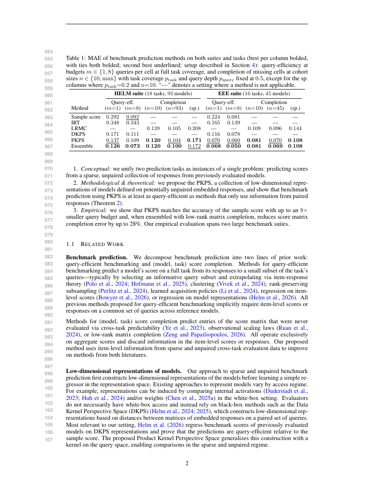
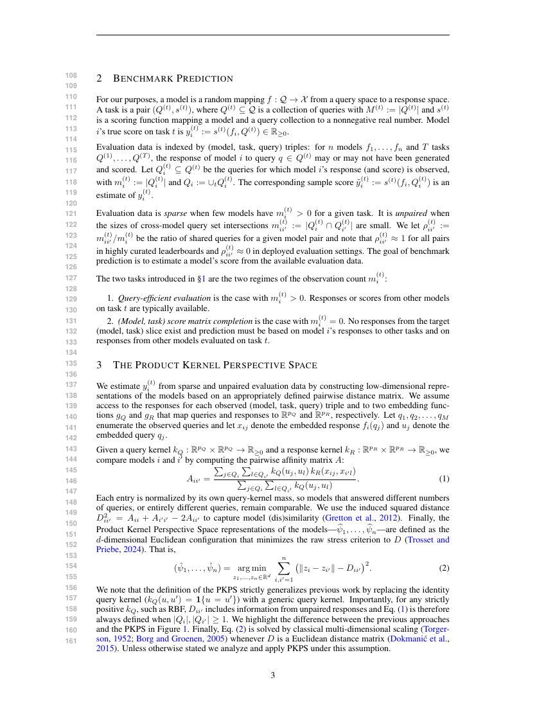
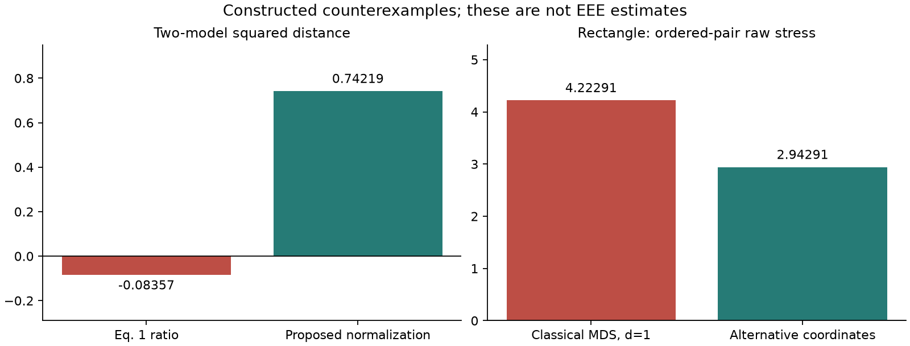
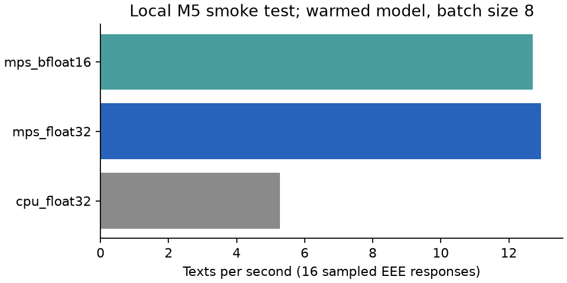
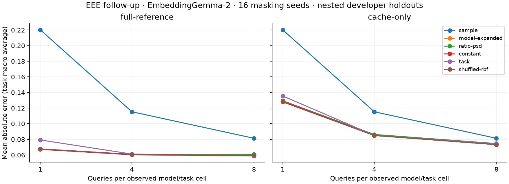
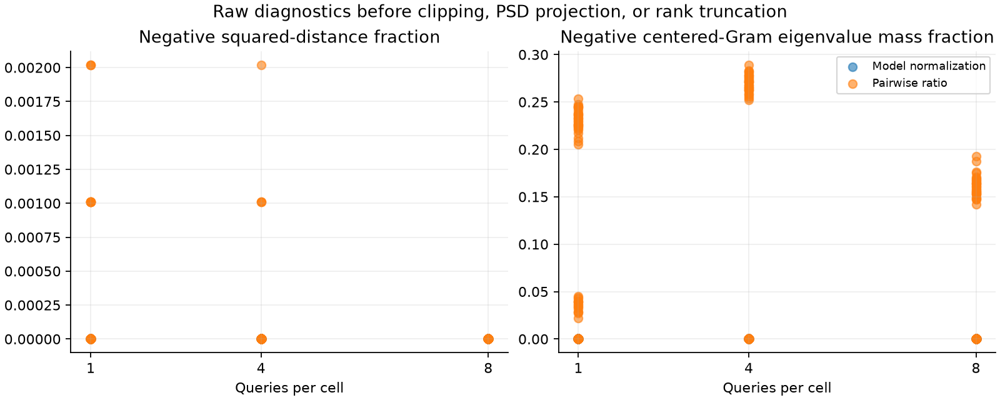
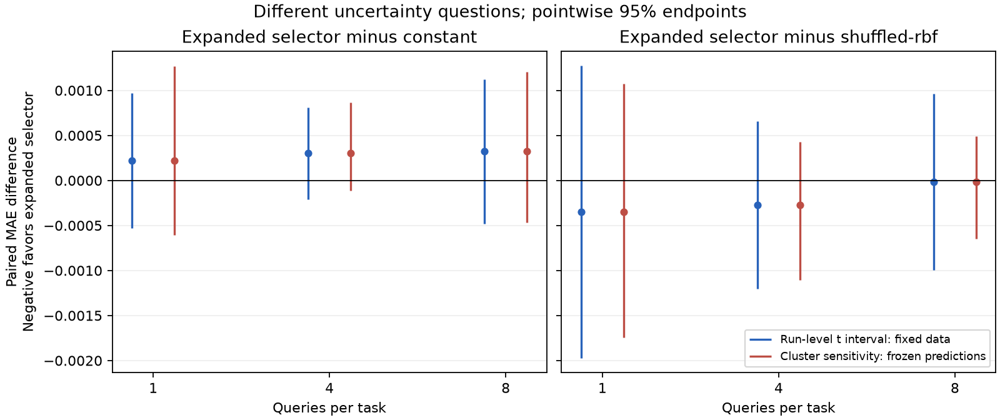
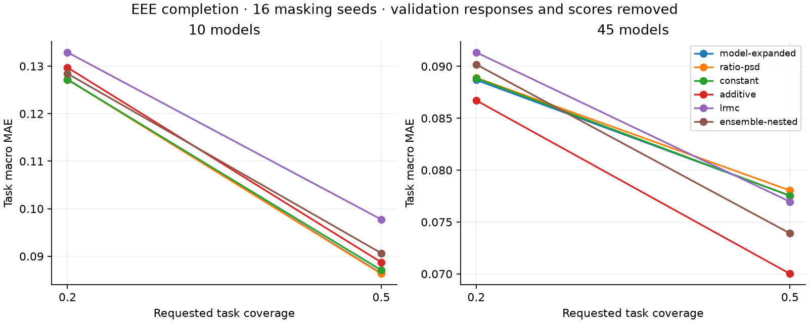
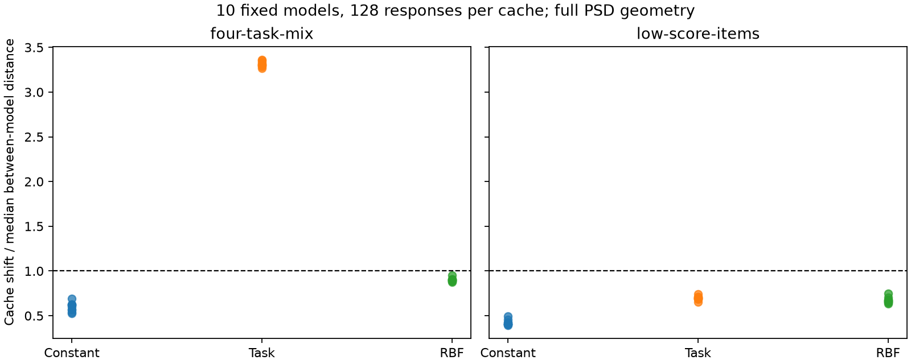
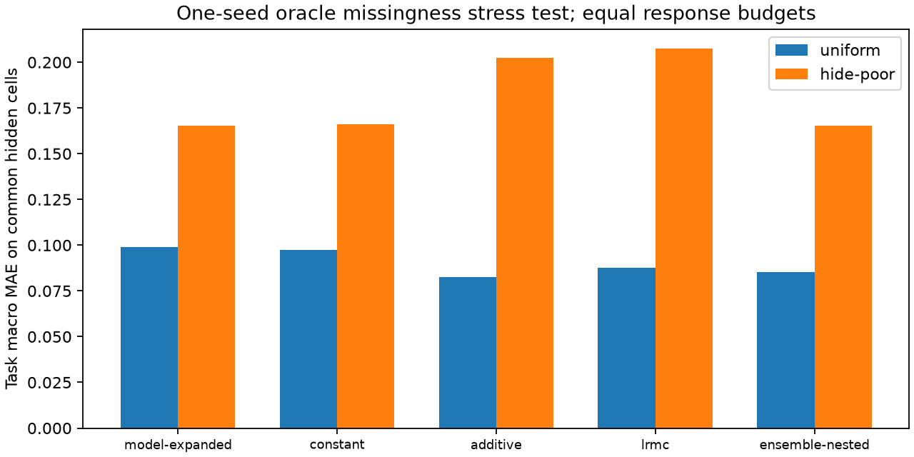

# PKPS stress-test audit and EEE revision plan

Audit date: 2026-10-12. Code reviewed at commit
`4097f3a3b95020504eed50ea2ff602a9e1df2029`.

This document records mathematical repairs, implementation findings, proposed
manuscript changes, and local follow-up experiments for *Predicting Benchmark Scores
from Sparse and Unpaired Cached Responses*. Completed checks and measurements are
distinguished from proposed changes; the historical paper results are not replaced
by measurements from a different embedding model.

The review considered the supplied `Stress Test Claims.pdf` and
`pkps_mathematical_checks.py` as evidence to assess, not instructions to execute.
The mathematical examples were independently recomputed. The examples below make
the main findings reproducible without those external attachments.

Mathematics uses GitHub's supported inline math and fenced `math` blocks, following
[GitHub's mathematical-expression guide](https://docs.github.com/en/get-started/writing-on-github/working-with-advanced-formatting/writing-mathematical-expressions).
The formulas below are explicit manuscript replacements or qualified proof steps;
they do not depend on custom macros from the paper's LaTeX preamble.

| Formula to revise | Replacement supplied here | Status |
| --- | --- | --- |
| Eq. 1, `eq:A` | Per-model query-mass normalization and its Gram feature map | Implemented in follow-ups; estimator and population target change |
| Eq. 2, `eq:mds` | Positive-eigenvalue, rank-constrained Gram approximation | Implemented in follow-ups |
| Definition 2, `def:pop`; `lem:conc` | Matching population affinity, diagonal V-statistic expectation, and conditional perturbation bound | Algebra supplied; new stochastic/spectral theorem still needs proof |
| `lem:noisy` | Conditional weighted-noise decomposition | Requires explicit conditional noise assumptions |
| `thm:qeff` | Guarded selector and qualified risk statement | Valid under the stated independent-validation assumptions; ordinary CV does not implement it |
| Ensemble in Appendix C | Inner predictions excluding the entire outer family's full labels | Implemented in follow-ups |
| Reporting and uncertainty | Paired task-macro loss, SEM, t/Bonferroni intervals, and bootstrap statistics | Matches the uncertainty-audit implementation; scope of inference stated |

[Numerical formula checks](artifacts/stress-test/math_formula_checks.json) verify
the diagonal expectation by exact enumeration, the weighted-noise decomposition,
the guard's tail-bound constant, and the t quantiles. Random numerical checks of
the conditional perturbation inequalities supplement the algebra below; these
checks do not establish the outstanding stochastic or population-coverage claims.

## Status and scope

| Work | Status |
| --- | --- |
| Read the manuscript and trace the relevant code paths | Completed |
| Independently reproduce the negative-distance and raw-stress examples | Completed; values and reproduction below |
| Demonstrate the ensemble's indirect full-score dependency | Completed in an isolated numerical example; benchmark impact unmeasured |
| Propose a positive-semidefinite affinity and consistent MDS definition | Implemented and tested in the separate follow-up drivers; revised statistical proofs pending |
| Modify estimators, preprocessing, validation, or manuscript | Corrected follow-up pipeline implemented; original package defaults and manuscript unchanged |
| Add EmbeddingGemma-2 support and test it on a Mac | Completed: MPS float32 and bfloat16 verified against CPU; float32 selected |
| Download EEE and regenerate embeddings | Completed: 225 pinned runs SHA256-verified; all 28,590 unique texts embedded on M5 MPS |
| Run benchmark follow-ups | Completed: 48 query-budget/seed runs, 64 completion runs, and controlled E5/E6 probes; results below |

Initial audit used standard-library reproductions. Subsequently the supplied NumPy
checks were executed in the existing `py314` conda environment. Because this package
requires Python <3.13, the installed conda distribution was used to create the
project-local `.conda-eee` Python 3.12 environment. The unchanged package baseline
passed **29 tests** (three warnings). Existing result CSVs remain historical results,
not validation of the proposed changes.

### Reference PDF and evidence

The user-supplied `pkps_iclr (1).pdf` (21 pages) is the authoritative reference for
this audit. SHA256:
`74c4f64cca84fcb5eb0c84479305dab909929d7574779bad0ab738be063034c6`.
Its Table 1 agrees with the corresponding table in `writing/main.tex`. Page numbers
below are PDF page numbers, also matching the printed page numbers.

| Paper location | Verification and implication |
| --- | --- |
| p. 3, Eq. 1, lines 143–149 | Pair-specific query-mass normalization is the construction disproved by the negative-distance example. The later Euclidean assumption makes the theory conditional; it does not establish that Eq. 1 satisfies the assumption. |
| p. 3, Eq. 2, lines 151–161 | The raw-stress/classical-MDS equivalence is asserted even for dimension reduction. The rectangle counterexample directly contradicts that assertion. |
| p. 14, lines 731–745 | Observed-only PCA, a near-delta candidate in bandwidth CV, and d=8 are specified. The audited driver fits preprocessing before masks and does not include its near-delta embedding among CV candidates. |
| p. 14, lines 747–755 | The claimed common logit/standardization/bias pipeline differs from the raw-score query-efficiency driver. |
| p. 15, lines 763–767 | The assertion that no predicted family's full scores enter the ensemble requires nested predictions; deleting validation rows alone is insufficient. |
| p. 15, lines 769–794 | Published sweeps use 16 seeds and Gemini embeddings. New EmbeddingGemma pilot measurements must be identified separately. |
| p. 16, lines 810–849 | The 45 model names match the pinned cohort exactly. The statement that all EEE scores are binary conflicts with fractional judging scores in the snapshot and the archived IRT coverage. |

Rendered evidence (from the supplied PDF, using `pdftoppm -r 100 -png`):





The [preprocessing/regression page](artifacts/stress-test/paper-14.png) and
[ensemble/evaluation page](artifacts/stress-test/paper-15.png) are retained too.
The [EEE composition and binary-score assertion](artifacts/stress-test/paper-16.png)
are retained on page 16.

### Local execution record

- Dataset: `evaleval/EEE_datastore`, revision
  `8b9632422dd2b3806431efd758c7cdc84044169f`; latest manifest `added_at` per
  model/benchmark, restricted to the intersection of the five named collections.
- Downloaded and checksum-verified **225 runs, 45 models, 16 tasks** in
  `/Users/avijit/Documents/EEE Datastore`. Full-depth targets were calculated before
  sampling. A deterministic cap of 32 yields **23,040 response rows and 6,774 unique
  query IDs**. This is not the paper's 30,304-row response pool (p. 15).
- Provenance, full-depth targets, and pooled rows are under `data/eee-followups/`;
  large raw data/model weights remain ignored by Git. The sampling and download
  implementation is [prepare_eee_followups.py](scripts/data/prepare_eee_followups.py).
- All 225 aggregate companion files were also preserved with SHA256 hashes,
  source dataset definitions, metrics, evaluation timestamps, and generation
  configurations. The [metadata summary](artifacts/stress-test/dataset_metadata_summary.json)
  records 15–16 distinct generation configurations within each collection; these
  are properties of the historical cached runs, not controlled generation settings.
- Hardware: Apple M5, 10 GPU cores, Metal 4; macOS 27.0.1. PyTorch 2.14.1 reports
  `is_built=True`, `is_available=True` outside the execution sandbox. A sandboxed
  probe reports unavailable; this is a process-access limitation, not missing M5
  support. Use `device='mps'` and fail explicitly if unavailable.
- Model: `google/embeddinggemma-2`, revision
  `914f7f89142e33e77833254d9c9b90c3cef7303b`, downloaded locally. The
  [new adapter](scripts/data/embed_eee_followups.py) disables vision/audio encoders,
  uses the same symmetric prompt for query and response embeddings, and writes
  resumable shards. CPU fallback is disabled during GPU measurements. The processor
  still requires Pillow and torchvision even with unused encoders disabled.

The full-target audit found **three scored rows with empty response text**. Pool
eligibility and target construction are now separate: those rows contribute to
full-depth scores but cannot enter the response embedding pool. A regression test
covers this distinction. The initial discrepancies from stored aggregate scores
were below 0.0009 but were systematic, not numerical roundoff.
After the correction, **all 720 full-depth target cells agree with the pinned
companion aggregates to 1.12e-16**; see the
[cell-level verification](artifacts/stress-test/target_score_verification.csv).
All 45 model names match PDF p. 16, and the
[full-depth counts for all 16 tasks](artifacts/stress-test/task_depths.csv) match
Table 3 exactly for every model (including the scored empty responses).

### Check against the reported EEE results

The [Table 1 comparison](artifacts/stress-test/paper_table1_eee_check.csv) recomputes
archived CSV summaries using the paper's order: mean over reported tasks within
each seed, then mean over seeds. This checks reporting consistency, not independent
replication. The important EEE points are:

| Setting | Sample / LRMC | PKPS | Ensemble |
| --- | ---: | ---: | ---: |
| Query efficiency m=1 | 0.223843 | 0.070025 | 0.067784 |
| Query efficiency m=8 | 0.081330 | 0.059524 | 0.049769 |
| Completion n=10, coverage=0.5 | 0.108820 | 0.080790 | 0.080798 |
| Completion n=45, coverage=0.5 | 0.095749 | 0.070436 | 0.069033 |
| Completion n=10, coverage=0.2 | 0.144232 | 0.108118 | 0.107764 |

These round to the corresponding entries in the supplied PDF. Among the other
entries, DKPS at m=8 is **0.07749555** in the CSV, which rounds directly to 0.077,
while the paper prints 0.078. Double rounding could explain the tiny difference,
but that provenance has not been established; regenerate directly from the saved
unrounded summaries.

IRT at m=1 is 0.164993 **only under the reported-task/seed aggregation**: it has
finite error on just **2–7 of the 16 tasks per seed** (7 tasks at m=8).
[Per-seed coverage](artifacts/stress-test/archival_task_coverage.csv) is recorded.
Its table error therefore does not represent the same supported task set as the
other methods. Add coverage and a matched-task comparison before interpreting
that number as an across-method ranking.

The supplied PDF also says all EEE scores are binary (p. 16, lines 816–817).
The [score-value audit](artifacts/stress-test/score_value_audit.csv) instead finds
**0.5-valued JudgeBench scores and 0.25-valued RewardBench 2 scores**, affecting
589 of 23,040 pooled rows across all nine judging tasks. Only the seven accuracy
tasks have exclusively binary pooled scores. Replace the binary-score assertion,
restrict the binary Rasch baseline to its supported tasks, and report matched
coverage; do not silently threshold graded scores into binary labels. If the
original study used a differently processed snapshot, supply and document it.

The [matched-task recomputation](artifacts/stress-test/archival_matched_irt_tasks.csv)
gives, at m=1, sample **0.150186**, IRT **0.164993**, DKPS **0.101646**, PKPS
**0.054057**, and ensemble **0.051556**. In particular, IRT does not outperform the
sample baseline on its own supported tasks, despite that apparent ordering in the
unmatched Table 1 entries. This is a concrete reporting correction based on the
paper's existing results, independent of the new embedding experiment.

One additional configuration mismatch: p. 15 specifies the EEE cohort sweep as
`{10,20,30,45}`, while both archived query-efficiency and completion sweep CSVs
contain `{10,20,40,45}` (16 seeds each). Correct the text to the actual grid or
provide the missing 30-model rerun. The Table 1 endpoints at 10 and 45 are unaffected.
Also clarify whether the paper's larger embedding workload count (30,304 responses)
includes models embedded before restricting to the 45-by-16 cohort: the latter's
32-query-per-cell pool has at most 23,040 responses.

## 1. Repair the affinity and embedding definition

### Finding: pair-specific normalization can produce negative squared distances

For the RBF query kernel with bandwidth 1 and linear response kernel, use query
coordinates `[-1, 1]` for one model and `[-2, 2]` for another. Each model's two
response vectors are `(1, 0)` and `(0, 1)`. The paper's ratio affinity gives

```text
A = [[0.880797077978, 0.982013790038],
     [0.982013790038, 0.999664649870]]
D12^2 = -0.0835658522284
negative centered-Gram eigenvalue = -0.0417829261142
```



[Exact numeric values](artifacts/stress-test/mathematical_counterexamples.json)
and a [vector PDF](artifacts/stress-test/mathematical_counterexamples.pdf) are saved.

This disproves a general geometric guarantee for that normalization. It does not
disprove a theorem explicitly conditional on Euclidean distances.

Both `ProductKernelPerspectiveSpace.fit` / `dist_matrices` in
[unpaired_dkps.py](../../dkps/unpaired_dkps.py) and `PKPS._dist_matrix` in
[pkps.py](../../dkps/pkps.py) clamp negative squared distances to zero. Clamping
allows a square root but does not ensure a Euclidean distance matrix. Diagnostics
must inspect the raw values before that information is lost.

### Proposed main construction: normalize separately by model

Define

```math
S_{ij}=\sum_{a\in Q_i}\sum_{b\in Q_j}
k_Q(u_a,u_b)k_R(x_{ia},x_{jb}),\qquad
Z_{ij}=\sum_{a\in Q_i}\sum_{b\in Q_j}k_Q(u_a,u_b).
```

Here $Q_i$ indexes cached observations, preserving multiplicities, and
$m_i=|Q_i|>0$. A query ID alone need not uniquely index a response if repeated
responses are retained. The unequal-budget form is equivalently

```math
\widehat s_{ij}=\frac{S_{ij}}{m_i m_j},\qquad
\widehat z_i=\frac{Z_{ii}}{m_i^2},\qquad
\widetilde A_{ij}
=\frac{\widehat s_{ij}}{\sqrt{\widehat z_i\widehat z_j}}
=\frac{S_{ij}}{\sqrt{Z_{ii}Z_{jj}}}.
```

Replace the original $A_{ij}=S_{ij}/Z_{ij}$ with

```math
\widetilde A_{ij}=\frac{S_{ij}}{\sqrt{Z_{ii}Z_{jj}}}.
```

Require positive-semidefinite query and response kernels and $Z_{ii}>0$. RBF query
kernels satisfy the latter for nonempty caches. A linear response kernel is
positive semidefinite even though individual kernel values can be negative;
the manuscript should not require its codomain to be nonnegative.

To see the geometric guarantee, let $\phi_Q$ and $\phi_R$ be kernel feature maps and
define

```math
v_i=\frac{\sum_{a\in Q_i}\phi_Q(u_a)\otimes\phi_R(x_{ia})}
{\sqrt{Z_{ii}}}.
```

Then $\widetilde A_{ij}=\langle v_i,v_j\rangle$, so $\widetilde A$ is positive
semidefinite and

```math
D_{ij}^2=\widetilde A_{ii}+\widetilde A_{jj}-2\widetilde A_{ij}
=\|v_i-v_j\|^2\ge0.
```

This construction agrees with the original affinity when all models have the same
query set, with matching multiplicities. The delta query kernel on a common query
set recovers paired DKPS. With $k_Q\equiv1$ and a linear response kernel, it gives
the inner products of mean response embeddings, including unequal cache sizes.

This is a changed estimator and population estimand. Its statistical guarantees
and empirical performance must be established anew. In particular, it does not
remove dependence on task mix, difficulty, or other query-design differences.
At zero exact overlap its delta-kernel version is defined, but is not the same
procedure as the original undefined-distance fallback.

### Replace raw stress with the spectral objective actually used

The current `eq:mds` in [main.tex](writing/main.tex) defines a raw-stress minimizer
and then identifies it with classical MDS. These differ under dimension reduction.
For a 2-by-1 rectangle reduced to one dimension:

```text
Classical coordinates: [-1, 1, -1, 1]
Alternative coordinates: [-1.1, 0.9, -0.9, 1.1]
Classical raw stress:   4.222912360003
Alternative raw stress: 2.942912360003
```

Use a consistent spectral definition instead:

```math
J=I-\frac1n\mathbf1\mathbf1^\top,\qquad
B=J\widetilde A J,\qquad
\widehat\Psi=U_d\Lambda_d^{1/2}.
```

Here $U_d$ contains eigenvectors for the largest positive eigenvalues, retaining
at most $d$ of them. This produces a best rank-at-most-$d$ positive-semidefinite
approximation of $B$ in Frobenius norm. It need not minimize raw distance stress.
If numerical rank is below $d$, use the available positive directions; handle a
zero-rank result explicitly. Only tolerance-sized negative values may be treated
as roundoff after the PSD construction.

For a direct replacement of Eq. 2, write the objective and its solution explicitly:

```math
\begin{aligned}
B&=J\widetilde A J=-\tfrac12 J D^{\circ 2}J,\\
B&=U\mathrm{diag}(\lambda_1,\ldots,\lambda_n)U^\top,
\quad \lambda_1\ge\cdots\ge\lambda_n,\\
\widehat G_d
&\in\underset{G=G^\top,\ G\succeq0,\ \mathrm{rank}(G)\le d}{\arg\min}
\|B-G\|_F^2,\\
\widehat G_d&=\sum_{\ell=1}^{\min(d,n)}\max(\lambda_\ell,0)u_\ell u_\ell^\top,\\
\widehat\Psi\widehat\Psi^\top&=\widehat G_d.
\end{aligned}
```

$D^{\circ 2}$ denotes elementwise squared distances. Factor $\widehat G_d$ using
the retained positive eigenvalues; zero-pad coordinates if exactly $d$ columns
are required. An eigenvalue tie can make the best rank-$d$ approximation nonunique.
The displayed minimization is over Gram matrices, not the raw-distance stress in
the original Eq. 2. The identity with $J\widetilde A J$ uses raw squared distances,
before any entrywise clipping. This definition also specifies the positive-part
projection used for the original-ratio comparison.

Use a symmetric eigendecomposition with explicit signed-eigenvalue handling.
Do not assume the installed `ClassicalMDS` implementation has the intended behavior
on indefinite input, or substitute absolute eigenvalues for positive eigenvalues.

Keep the original ratio affinity with explicit positive-part projection of $JAJ$
as a comparison. For this comparison, form $JAJ$ directly before distance clipping.
Projection changes the geometry and must be reported as part of the estimator.

## 2. Align the theory with the estimator and information budget

The labels below refer to [the manuscript source](writing/main.tex).

### Replace the population affinity alongside Eq. 1

In Definition 2 (`def:pop`), let $W_i=(U_i,X_i)\sim P_i$, with independent copies
used in every expectation below, including self-pairs. Assume the kernel feature
means exist. Define the query and joint feature means, self-mass, and population
affinity by

```math
\begin{aligned}
\eta_i&=\mathbb E_{P_i}[\phi_Q(U_i)],
&\mu_i&=\mathbb E_{P_i}[\phi_Q(U_i)\otimes\phi_R(X_i)],\\
z_i^*&=\mathbb E[k_Q(U_i,U_i')]=\|\eta_i\|^2>0,
&s_{ij}^*&=\mathbb E[k_Q(U_i,U_j')k_R(X_i,X_j')]
=\langle\mu_i,\mu_j\rangle,\\
v_i^*&=\frac{\mu_i}{\sqrt{z_i^*}},
&\widetilde A_{ij}^*&=\frac{s_{ij}^*}{\sqrt{z_i^*z_j^*}}
=\langle v_i^*,v_j^*\rangle,\\
(D_{ij}^*)^2&=\|v_i^*-v_j^*\|^2,
&B^*&=J\widetilde A^*J.
\end{aligned}
```

The relevant normalization lower bound is now **self query mass**,
$\kappa_Q=\min_i z_i^*>0$, rather than the old minimum cross-model mass.
Use the same positive-eigenvalue definition for the population coordinates.
Neither positive self-mass nor this Gram representation implies score regularity,
query-design invariance, or accuracy under missingness. Those require additional
assumptions or evidence. The cached finite-benchmark sampling design also needs
its own analysis; it is not automatically the i.i.d. population model above.

### Correct the diagonal term and state a conditional perturbation bound

The self terms in `lem:conc` use a **V-statistic**, not two independent samples.
For i.i.d. $W_1,\ldots,W_m\sim P_i$ and
$h(W,W')=k_Q(U,U')k_R(X,X')$, the exact expectation is

```math
\begin{aligned}
\widehat s_{ii}&=\frac{1}{m^2}\sum_{a=1}^{m}\sum_{b=1}^{m}h(W_a,W_b),\\
\mathbb E[\widehat s_{ii}]
&=\left(1-\frac1m\right)s_{ii}^*
+\frac1m\mathbb E[h(W,W)],\\
\mathbb E[\widehat s_{ii}]-s_{ii}^*
&=\frac{\mathbb E[h(W,W)]-s_{ii}^*}{m},\\
\mathbb E[\widehat z_i]-z_i^*
&=\frac{\mathbb E[k_Q(U,U)]-z_i^*}{m}.
\end{aligned}
```

These are expectations of the numerator and self-mass separately; they do not
make the normalized ratio unbiased. Keeping the diagonal terms preserves the
empirical Gram construction. Subtracting diagonal bias entry by entry would need
a new PSD argument. Within-sample dependence, the displayed bias, and the actual
finite-population sampling must be included in a stochastic proof.

One valid algebraic transfer bound is available without asserting a stochastic
rate. Suppose $|s_{ij}^*|\le M$, $z_i^*\ge\kappa_Q$, and an event satisfies

```math
\max_{i,j}|\widehat s_{ij}-s_{ij}^*|\le\varepsilon_S,
\qquad
\max_i|\widehat z_i-z_i^*|\le\varepsilon_Z\le\frac{\kappa_Q}{2}.
```

On that event, all empirical self-masses are at least $\kappa_Q/2$, and

```math
\begin{aligned}
\max_{i,j}|\widetilde A_{ij}-\widetilde A_{ij}^*|
&\le\frac{2\varepsilon_S}{\kappa_Q}
+\frac{4M\varepsilon_Z}{\kappa_Q^2}
\;=:e_A,\\
\|J(\widetilde A-\widetilde A^*)J\|_{\mathrm{op}}&\le n e_A,\\
\max_{i,j}|D_{ij}^2-(D_{ij}^*)^2|&\le4e_A.
\end{aligned}
```

For the first bound, split the numerator error from the denominator error. On
$x,y\ge\kappa_Q/2$, each partial derivative of $(xy)^{-1/2}$ has magnitude at
most $2/\kappa_Q^2$. The remaining bounds follow from centering's operator norm
one and the four affinity contributions to a squared distance. This does **not**
yet prove a high-probability representation rate: one must establish the event
under the chosen sampling assumptions and then apply a justified spectral
perturbation result with the relevant eigenvalue gap. The paper's original
concentration constants and query-efficiency theorem do not transfer unchanged.

| Claim or proof component | Required revision |
| --- | --- |
| `thm:qeff`, noninferiority | State a guarantee for a guarded selector that contains the baseline. Ordinary CV and an arbitrary nonzero bandwidth do not inherit it. |
| `def:qeff`, strict fixed-budget improvement | Remove this conclusion unless a new proof establishes it. The current strict-improvement argument lets query budgets grow. State explicit joint conditions on model count, budget, and spectral gap. |
| `lem:noisy`, averaging neighbor score noise | Neighbor selection depends on the responses used to estimate scores. Establish conditional mean-zero noise using independently sampled labels, or analyze the selection dependence. |
| Validation against true scores | Specify exact reference labels, or prove the result for available noisy labels. Under suitable conditional independence, squared-loss noise contributes a candidate-independent term; this does not automatically hold for MAE. |
| `lem:conc`, diagonal affinities | Self-affinities reuse one sample and contain diagonal terms. Treat them as within-sample V-statistics and account for bias/dependence. The two-independent-samples argument is insufficient for them. |
| Preprocessing and spectral concentration | Specify fixed or separately fitted feature maps, the revised population affinity, and relevant positive-eigenvalue gaps. Do not silently carry the original constants to the new normalization. |
| Comparison at zero pairing | Identify the exact baseline and its fallback. Failure of a method discarding unmatched responses is not a lower bound for every sparse-data estimator. |

If sample splitting is used, count feature, label, and validation responses in the
budget. Disjoint subsets of a fixed finite benchmark are not automatically
conditionally independent; justify the sampling design rather than invoking
splitting alone. Developer-related models also need a dependence-aware validation
analysis rather than being counted as independent validation units.

A possible fixed-budget analysis would target residual risk such as
$\mathbb E[\mathrm{Var}(Y\mid C_m)]$, where $C_m$ is the permitted cache or a
fixed representation of it. More reference models cannot generally eliminate
uncertainty absent from a fixed target cache. This is a direction for new theory,
not an established result for the current jointly fitted MDS estimator.

### Correct the noisy-reference variance term

For `lem:noisy`, write reference scores as $\widetilde y_i=y_i+\epsilon_i$ and
the prediction as $\widehat y_0=\sum_i w_i\widetilde y_i$, with nonnegative
weights summing to one. Let $\mathcal F$ include the selected references, weights,
true scores, and feature information used in selection. The following decomposition
requires $\mathbb E[\epsilon_i\mid\mathcal F]=0$ and conditionally uncorrelated
reference noises; these are assumptions to justify, not consequences of kNN:

```math
\begin{aligned}
\mathbb E[(\widehat y_0-y_0)^2\mid\mathcal F]
&=\left(\sum_i w_i y_i-y_0\right)^2
+\sum_i w_i^2\mathrm{Var}(\epsilon_i\mid\mathcal F),\\
\mathrm{Var}(\epsilon_i\mid\mathcal F)\le\frac{\sigma_q^2}{m_i}
&\quad\Longrightarrow\quad
\mathbb E[(\widehat y_0-y_0)^2\mid\mathcal F]
\le\left(\sum_i w_i y_i-y_0\right)^2
+\sigma_q^2\sum_i\frac{w_i^2}{m_i}.
\end{aligned}
```

Only equal weights on $K$ references with equal budget $m$ reduce the final term
to $\sigma_q^2/(mK)$. Distance-weighted kNN generally does not; with equal budgets
its effective reference count is $K_{\mathrm{eff}}=1/\sum_i w_i^2\le K$.
Without conditional uncorrelatedness, retain
$\sum_{i,j}w_iw_j\mathrm{Cov}(\epsilon_i,\epsilon_j\mid\mathcal F)$.
Without conditional zero means, a selection-bias term also remains. Features and
scores derived from the same responses need not satisfy either condition.
Independent label sampling can help only when its independence is justified and
its extra queries are counted. This squared-loss identity does not supply an MAE
guarantee or prove the paper's fixed-budget strict-improvement claim.

### A valid guarded-selector statement to replace the unconditional claim

One limited replacement can be proved without assuming that ordinary CV is a
guard. Freeze a baseline $h_0$ and $K$ candidate predictors before observing an
independent validation set of $N$ i.i.d. evaluation units. Predictions and labels
are in $[0,1]$, $N,K\ge1$, and $0<\delta<1$. Let $\widehat\Delta_k$ be the mean
validation difference in squared loss, candidate minus baseline, and set

```math
\epsilon_N=\sqrt{\frac{2\log(K/\delta)}{N}}.
```

The complete replacement rule and its target risk are

```math
\begin{aligned}
R(h)&=\mathbb E[(h(X)-Y)^2],\\
\widehat\Delta_k
&=\frac1N\sum_{r=1}^{N}
\left[(h_k(X_r)-Y_r)^2-(h_0(X_r)-Y_r)^2\right],\\
\mathcal K_{\mathrm{safe}}
&=\{k\in\{1,\ldots,K\}:\widehat\Delta_k+\epsilon_N\le0\},\\
\widehat h
&=\begin{cases}
h_0,&\mathcal K_{\mathrm{safe}}=\varnothing,\\
h_{\widehat k},\quad
\widehat k\in\underset{k\in\mathcal K_{\mathrm{safe}}}{\arg\min}\widehat\Delta_k,
&\mathcal K_{\mathrm{safe}}\ne\varnothing,
\end{cases}\\
\Pr\{R(\widehat h)\le R(h_0)\}&\ge1-\delta,
\qquad
\mathbb E[R(\widehat h)-R(h_0)]\le\delta.
\end{aligned}
```

The probability and final expectation are over the independent validation sample,
conditional on the frozen candidate predictors; $R$ uses a fresh evaluation unit
from that same population. The risk-difference loss has range length two, which
explains the factor two inside $\epsilon_N$.

Choose a candidate only if $\widehat\Delta_k+\epsilon_N\le0$; otherwise retain
$h_0$. Each loss difference lies in $[-1,1]$. One-sided Hoeffding plus a union
bound yields $\Delta_k\le\widehat\Delta_k+\epsilon_N$ simultaneously for all $K$
candidates with probability at least $1-\delta$. Thus, on that event, the selected
predictor's population squared risk is no worse than the baseline's.
Since excess risk is at most 1 on the remaining event, expected excess risk is at
most $\delta$. Taking $\delta_N\to0$ gives weak asymptotic noninferiority for this
guarded procedure; useful candidate acceptance additionally needs
$\log(K/\delta_N)/N\to0$. The baseline must be the actual comparator, including
its zero-overlap behavior, rather than an informal near-delta surrogate.

This establishes **high-probability guarded noninferiority under explicit
validation assumptions**, not strict improvement, an unconditional expected-risk
ordering, or a property of the current CV implementation. Strict improvement
requires a candidate with a sufficient risk margin and enough validation data.
The validation units cannot be correlated cells counted as independent models.
If noisy labels replace true scores, the expected squared-loss difference is
preserved only with the required conditional zero-mean noise relative to both
predictors; reusing the same response-derived label can violate that condition.
All extra validation observations must be counted. The local pilot below uses
ordinary nested MAE selection and therefore does **not** claim this theorem.

The fixed-budget quantifiers must also remain distinct. Even a repaired statement
of the first form below would not establish the second:

```math
\underbrace{\forall\epsilon>0\ \exists n_\epsilon,m_\epsilon:
R(h_{n_\epsilon,m_\epsilon})\le\epsilon}_{\text{budgets may grow with desired accuracy}}
\quad\not\Longrightarrow\quad
\underbrace{\forall m\ \lim_{n\to\infty}R(h_{n,m})=0}_{\text{fixed target budget}}.
```

Neither displayed achievability assertion is proved here for the revised
estimator. Supply a proof with explicit model-count, query-budget, and spectral
conditions before replacing the original strict-improvement theorem.

## 3. Implementation findings and required changes

| Finding | Evidence in code | Change |
| --- | --- | --- |
| Query efficiency regresses on full reference scores | `_regress` passes `score_mat` to `_lofo_regress` in [query_efficiency.py](scripts/experiments/query_efficiency.py) | Add explicit full-reference and cache-only regimes; keep evaluation targets separate. |
| Completion uses sampled observed scores | `trial` constructs `samp` and fits predictors to it in [completion.py](scripts/experiments/completion.py) | Describe this information regime separately from query efficiency. Record scoring depth and embedding depth, which can differ. |
| PCA is fitted before observation masks | `load_eee` reduces the entire response pool and query collection in [loaders.py](scripts/pipeline/loaders.py); drivers subsequently subset them | Load frozen unreduced embeddings first, apply masks, then fit PCA, dimension selection, and bandwidth scales on permitted data. |
| Outer-family scores can indirectly influence ensemble weights | `run_seed` reuses `pk_mat` across all outer families; [Ensemble._learn](../../dkps/ensemble.py) has the analogous structure | Regenerate inner predictions within each outer split, excluding outer-family full scores from every inner training set. |
| Near-delta baseline is absent from the actual CV candidate dictionary | `Ds` includes `SIG_DELTA`, but `Zs` contains only `SIG_GRID` in `run_seed` | If claiming guarded selection against DKPS, include the actual baseline and implement the guard. Small RBF bandwidth is not exact ID matching. |
| Claimed disjoint sampling can reuse queries | `run_seed(disjoint=True)` falls back to `idx` when no unused query is available | Enforce feasibility, fail or adjust the design, and report actual overlap and counts. |
| Query-efficiency regression differs from the common pipeline described in the appendix | `_lofo_regress` in [query_select.py](scripts/pipeline/query_select.py) fits raw-score kNN or OLS | Describe the actual protocol and match it across controls, or explicitly change and rerun the pipeline. |

The full-reference regime is legitimate. Its use is not itself leakage: a new
target can be predicted from historical reference scores. It does not establish
performance when every reference label also comes from a tiny cache.

### Why the ensemble needs nested predictions

For an outer held-out family $F$, the ensemble chooses its blend weight using
predictions for other families $G$. Those predictions exclude $G$ but can have
been trained on $F$'s full scores. Excluding $F$ only from the final validation
rows does not remove this path:

```text
outer family's full scores
    -> predictions for other families
    -> selected ensemble weight
    -> outer family's ensemble prediction
```

An isolated example using nine models, three families, distance-weighted 5-NN,
and the existing 21-point weight grid gives:

| Quantity for the first target | Original full scores | Only outer-family full scores inverted |
| --- | ---: | ---: |
| Base prediction | 0.380605320874 | 0.380605320874 |
| Weight on own sample | 0.65 | 0.75 |
| Ensemble prediction | 0.133211862306 | 0.095151330219 |

The example demonstrates the dependency with fixed coordinates and sampled
scores. It is not an execution of the complete benchmark pipeline and does not
estimate the size of bias in the reported table. A test on one dataset or one
perturbation can also pass when a discrete selected weight happens not to change.

For each outer family, remove its forbidden full scores first. Generate inner
validation predictions using only remaining families, choose all supervised
hyperparameters and ensemble weights, then fit on those references and predict
the outer targets. Permitted target cache responses and scores may remain
available as specified by the protocol; full target scores may not.

For the full-reference query ensemble, the corrected equations are explicit.
Let $g(j)$ denote model $j$'s developer, $\mathcal V_F$ the validation cells outside
outer family $F$, and $p_{\theta,jt}^{(-F,-g(j))}$ the inner prediction trained
without either family's full labels. Let $\theta$ index the declared
kernel/bandwidth candidates and $\Gamma=\{0,0.05,\ldots,1\}$:

```math
\begin{aligned}
\widehat\theta_F
&\in\underset{\theta\in\Theta}{\arg\min}
\frac1{|\mathcal V_F|}\sum_{(j,t)\in\mathcal V_F}
|p_{\theta,jt}^{(-F,-g(j))}-y_{jt}^{\mathrm{ref}}|,\\
\widehat\alpha_F
&\in\underset{\alpha\in\Gamma}{\arg\min}
\frac1{|\mathcal V_F|}\sum_{(j,t)\in\mathcal V_F}
\left|\alpha\widetilde y_{jt}
+(1-\alpha)p_{\widehat\theta_F,jt}^{(-F,-g(j))}
-y_{jt}^{\mathrm{ref}}\right|,\\
\widehat y_{it}^{\mathrm{ens}}
&=\widehat\alpha_F\widetilde y_{it}
+(1-\widehat\alpha_F)p_{\widehat\theta_F,it}^{(-F)},
\qquad g(i)=F.
\end{aligned}
```

This specifies the implemented sequential kernel-then-weight selection, rather
than claiming a jointly optimized objective. The superscripts exclude forbidden
**full labels**; the declared transductive geometry can still use permitted
observed cache features. In the cache-only follow-up, the ensemble weight is fixed
at $1/2$, because validating the sample component against the same sampled labels
would be circular. The independent-validation risk guard is a separate procedure.

For completion, inner validation must remove the validation cells' responses
as well as scores. Leaving their response-derived features in the representation
validates a different, easier task. Refit affected preprocessing and geometry.

## 4. EEE follow-up design

### Freeze the data and information regimes

Start with `math-mc`, `gsm-mc`, `gpqa-diamond`, `judgebench`, and `reward-bench-2`.
The manuscript cohort has 45 models and 16 tasks; a fresh datastore revision need
not produce that cohort. Save the chosen model/task/run lists rather than assuming
the current store reproduces those counts.

Use the full instance-level companion files and pin the dataset revision. EEE's
documented `load_dataset(..., split="sample")` configurations expose viewer
samples, not complete collections. The [EEE dataset documentation](https://huggingface.co/datasets/evaleval/EEE_datastore)
describes revision-pinned downloads and immutable flat snapshots.

Preserve benchmark version, metric, run configuration, and provenance. Namespace
query IDs by benchmark/version and verify that an ID identifies consistent query
text. Select one compatible run per model/benchmark using a recorded rule;
filesystem modification times are not adequate provenance. Use the score parsing
in [dkps.eee](../../dkps/eee.py), including its handling of string scores. The
existing fetch helper resolves `main`; add revision support and separate caches
by revision before using it for this study.

| Regime | Reference information | Target information | Full evaluation targets |
| --- | --- | --- | --- |
| Full-reference | Budgeted response features plus full reference aggregate scores | Budgeted responses and permitted per-item scores | Outer family's full scores reserved for assessment |
| Cache-only | Observed responses and their scores only | Same observation policy | Full scores reserved for assessment everywhere |

Specify whether any baseline receives full reference **item-level** scores in
addition to aggregate scores. Do not give an IRT or other baseline an undocumented
information advantage or disadvantage. In cache-only tuning, any additional
validation item scores must count toward the declared budget; at $m=1$ they cannot
be introduced silently. Validation MAE against noisy labels is a different target
from MAE against full scores and must be described accordingly.

Build full-depth targets before the 32-query pool cap. Treat them as finite-run
reference measurements, not noise-free universal model capabilities. Keep the
truth table outside predictor inputs. Apply one observation mask to both response
and score access, and restrict learned preprocessing to allowed rows.

Frozen per-text embeddings can be computed and cached before experimental masks;
they have no fitted dependence on other rows. The training process must not access
hidden vectors or fit PCA on them. For a strict inductive protocol, fit reducers
and the reference geometry on training references and transform new models out of
sample. If a transductive protocol includes permitted target features in fitting,
label it explicitly and do not claim it implements the inductive guarded theorem.

### Experiment matrix

| ID | Comparison | Held fixed | Main question |
| --- | --- | --- | --- |
| E1 | Historical clipping pipeline; original affinity with PSD projection; proposed model-wise normalization | Embeddings, masks, regressor, score access | Does the geometric repair alter prediction quality? |
| E2 | Full-reference versus cache-only | Cohort, response masks, outer folds | Which score-access regime supports the gains? |
| E3 | RBF, exact delta, constant query kernel, task-only kernel, shuffled query embeddings | Normalization, regression, preprocessing, permitted labels | Does query semantics help beyond response means or task membership? |
| E4 | Sample mean, task mean/median, shrinkage, additive model/task bias, tuned LRMC, sparse Rasch, mean-response embeddings | Information access, outer splits, tuning opportunity | What remains beyond strong simple baselines? |
| E5 | Same underlying model with altered task mix, query difficulty, and available response-style variants | Model identity and total response budget | How much does cache design move representations and scores? |
| E6 | Uniform, specialist-biased, poor-score-hiding masks; temporal/developer holdouts; natural sparse caches | Declared budget and observable-information rules | Does performance extend beyond uniform induced missingness? |

For E3, permute query embeddings among unique IDs within each task and apply one
shared permutation to all occurrences of an ID. This preserves task membership
and exact matches while breaking semantic neighborhoods. A separate independent
per-model shuffle can probe correspondence destruction, but answers a different
question. Include both pooled mean response embeddings and task-balanced means;
specify how the latter handle absent tasks without using hidden responses.

Tune LRMC rank and regularization on inner splits. Fit sparse Rasch on observed
edges rather than requiring a dense rectangle; report connectivity and
identifiability limitations. Evaluate methods on matched supported cells and
report coverage/failures, so a baseline cannot improve its apparent error merely
by abstaining on difficult cells. Include a small deliberately shared-query
design at a matched total budget where feasible.

For E5, compare pairwise geometry or align embeddings before comparing coordinates
because MDS orientation is arbitrary. Synthetic score-dependent masks in E6 may
use truth only in a separate mask generator, never in the learner. Natural missing
cells have no evaluation truth: assess them through later observed outcomes or
held-out known runs, and acknowledge remaining selection bias. Use genuine
availability timestamps for temporal evaluation, not upload order as a proxy for
model release without verification.

### Budgets, diagnostics, and reporting

The local design starts with three masking seeds and $m\in\{1,4,8\}$ at full task
coverage, then extends the main comparisons to 16 seeds after correctness checks.
Completion uses coverage $p\in\{0.2,0.5\}$ and cohorts of 10 and the full frozen
cohort. Use identical masks across methods. Report both per-task and
total target budgets: 16 tasks at $m=1$ means 16 responses, not one total response.
Account separately for historical reference labels and any additional validation
queries. Define completion depth relative to the capped pool or full benchmark
explicitly; the existing driver operates on its available pool.

Record raw negative-distance frequency/minimum, negative Gram eigenvalue mass,
projection distortion, spectral rank, query mass, actual overlap, and zero-mass
fallbacks. For pair-weight concentration, $(\sum w)^2/\sum w^2$ is a useful
descriptive diagnostic, but its pairs share queries and are not independent
observations. Strict positivity of an RBF is not evidence of useful overlap.

Report macro task/benchmark MAE, MSE for comparison to the theory, tail errors,
ranking inversions, and directional threshold errors. Save per-cell predictions.
Use paired method differences with benchmark- and developer-aware uncertainty;
masking seeds are repeated measurements of the same cohort. Report individual
benchmark results and sensitivity to removing each benchmark, since five
benchmarks provide limited evidence for generalization across domains.

Calibrate prediction intervals on separate allowed data, report empirical coverage
and width, and evaluate an overlap/uncertainty-based abstention policy. Do not
promise distribution-free coverage under arbitrary developer or temporal shift.
Label predicted benchmark entries as imputed and preserve their provenance.

## 5. Verified M5 setup and runnable local follow-ups

The original checkpoint runs directly through PyTorch's Metal backend (`mps`);
no MLX conversion or quantized checkpoint is required. Both float32 and bfloat16
were tested with 16 real EEE responses, batch size 8, after a warm-up:

| Backend | Elapsed time | Texts/s | Minimum cosine with MPS float32 |
| --- | ---: | ---: | ---: |
| CPU float32 | 3.038 s | 5.27 | 0.99999994 |
| M5 MPS float32 | 1.236 s | 12.95 | 1 |
| M5 MPS bfloat16 | 1.260 s | 12.70 | 0.999946 |

These are small-sample measurements, not a sustained-throughput guarantee. Float32
was chosen for the actual cache: bfloat16 did not improve this smoke-test time and
introduced a maximum component difference of 0.00228. Float32 GPU/CPU maximum
component difference was 3.58e-7. CPU fallback was disabled. Both configurations
produced finite normalized 768-dimensional embeddings. The adapter renormalizes
in float32 after encoding to avoid storing bfloat16 norm-rounding error.



[Raw smoke-test measurements](artifacts/stress-test/mps_smoke_test.json) and
[resolved environment](artifacts/stress-test/environment.txt) are saved evidence.
The latter is an environment inventory, not a portable requirements file (it
contains conda build paths and an editable checkout).

Google's [model card](https://huggingface.co/google/embeddinggemma-2) specifies
selective encoder loading, symmetric similarity prompts, and float32 or bfloat16;
**float16 is unsupported**. The pinned checkpoint's Sentence Transformers config
requires version 6.1+. This run uses Python 3.12.15, torch 2.14.1, transformers
5.19.0, sentence-transformers 6.1.0, Pillow 12.3.0, and torchvision 0.29.1.
The existing conda installation created `.conda-eee` because the user's `py314`
environment cannot satisfy this repository's Python <3.13 requirement.

```bash
# Reproduce setup using the existing conda installation (already done here).
/opt/miniconda3/bin/conda create --prefix "$PWD/.conda-eee" \
  --override-channels -c https://repo.anaconda.com/pkgs/main python=3.12 pip -y
.conda-eee/bin/python -m pip install -e . \
  'sentence-transformers==6.1.0' 'transformers==5.19.0' 'torch==2.14.1' \
  'torchvision==0.29.1' pillow huggingface_hub pyarrow python-dotenv rich pytest matplotlib

# Download the immutable model snapshot once.
HF_HUB_DISABLE_XET=1 .conda-eee/bin/hf download google/embeddinggemma-2 \
  --revision 914f7f89142e33e77833254d9c9b90c3cef7303b \
  --local-dir data/models/embeddinggemma-2 --exclude '*.onnx' --exclude '*.tflite'

# Full-depth targets are prepared before applying the 32-query pool cap.
.conda-eee/bin/python projects/pkps/scripts/data/prepare_eee_followups.py \
  --source '/Users/avijit/Documents/EEE Datastore' --download

# Run in a normal Terminal process with Metal access; the agent sandbox hides MPS.
.conda-eee/bin/python projects/pkps/scripts/data/embed_eee_followups.py --smoke
.conda-eee/bin/python projects/pkps/scripts/data/embed_eee_followups.py \
  --device mps --dtype float32 --batch-size 8 --max-length 2048
.conda-eee/bin/python projects/pkps/scripts/data/audit_eee_followups.py \
  --source '/Users/avijit/Documents/EEE Datastore' --token-lengths

.conda-eee/bin/python -m pytest tests -q
# Sixteen-seed outputs are separate from the initial three-seed pilot folders.
.conda-eee/bin/python projects/pkps/scripts/experiments/stress_followups.py \
  --out projects/pkps/artifacts/stress-test/query-16seed \
  --budgets 1 4 8 --seeds 0 1 2 3 4 5 6 7 8 9 10 11 12 13 14 15
.conda-eee/bin/python projects/pkps/scripts/experiments/stress_completion.py \
  --out projects/pkps/artifacts/stress-test/completion-16seed \
  --cohorts 10 45 --coverage 0.2 0.5 --m 16 \
  --seeds 0 1 2 3 4 5 6 7 8 9 10 11 12 13 14 15
MPLCONFIGDIR=/tmp/pkps-mpl .conda-eee/bin/python \
  projects/pkps/scripts/experiments/stress_cache_design.py
MPLCONFIGDIR=/tmp/pkps-mpl .conda-eee/bin/python \
  projects/pkps/scripts/experiments/report_stress_followups.py \
  --query-dir projects/pkps/artifacts/stress-test/query-16seed \
  --completion-dir projects/pkps/artifacts/stress-test/completion-16seed
MPLCONFIGDIR=/tmp/pkps-mpl .conda-eee/bin/python \
  projects/pkps/scripts/experiments/audit_stress_uncertainty.py --n-boot 100000
```

The separate follow-up drivers preserve the historical drivers and results.
Each embedding cache records revision, prompt, dtype, dimensions, truncation,
ordered-text hash, timings and dependencies, and can resume completed shards.
Changing those parameters requires a separate cache. All methods use the same
frozen encoder and observation masks. The pilot uses a **2,048-token limit**,
not the model's 8K maximum or the original script's 8,000-character truncation.
It uses full 768-dimensional unit vectors with no learned PCA; response/query
preprocessing therefore cannot fit hidden rows. These differences, as well as
changed tuning, prevent interpreting the pilot as an exact Table 1 reproduction.

The first long run reached Metal's allocation limit after approximately 10,000
saved texts (the error reported 3.52 GiB allocated by MPS and 38.51 GiB of other
allocations). The adapter now releases unused Metal allocations between shards
and retries memory failures with smaller batches, recording actual batch sizes.
It resumes existing shards and keeps the default GPU memory safety limit enabled.
The 2,048-token cap was independently checked on a 5,000-word tokenizer input.
The [token-length audit](artifacts/stress-test/token_lengths.json) counts **1,018
of 28,590 unique texts truncated (3.56%)**, including the similarity prompt.
Median input length is 158 tokens; the maximum is 181,503. The capped workload
contains about 9.05 million tokens, versus 15.43 million without truncation.
Long reasoning responses are therefore a relevant sensitivity limitation.

**Embedding is complete.** All 224 shards contain finite float32 vectors of shape
28,590 by 768; the maximum unit-norm error is 1.20e-7. All successful shards used
batch size eight. Successful shard encoding times total **46.44 minutes**, excluding
model loading, failed allocation work, restart delays, and setup. The
[completion record](artifacts/stress-test/embedding_completion.json) preserves the
cache fingerprint, settings, versions, counts, and checks. Reusing this cache does
not require further GPU inference for the experiments below.

The query-efficiency runner compares original ratio plus historical clipping/SVD,
original ratio plus signed PSD projection, and model normalization. It tunes each
RBF method on the same five bandwidth multipliers inside outer developer folds.
Controls are constant, exact delta, task-only, and shared within-task query shuffle.
An expanded model-normalized selector explicitly includes constant and delta.
All embedding methods use raw-score distance-weighted 5-NN, matching the audited
query-efficiency code rather than claiming to implement the appendix's logit
pipeline. Observed target features enter a transductive geometry, explicitly.

Full-reference training and validation receive only other developers' full scores.
Cache-only learning receives no full-score table. Tuning a sample/prior blend
against those same sample means would trivially favor the sample itself; therefore
cache-only uses a declared fixed 50:50 blend, while full-reference uses nested
21-point weight selection. No independent-label guarantee is claimed for noisy
cache-only bandwidth selection. Both regimes include task mean/median, own sample,
and fixed sample/task-mean shrinkage controls.

Completion uses observed sample scores only. Inner validation removes both scores
and response rows for 20% of observed cells, preserving at least one observed cell
per model/task. It recomputes the geometry and score preprocessing. Logit transform,
per-task standardization, and two-way additive bias are shared by perspective and
LRMC predictors. LRMC rank {1,2,4} and ridge {0.1,1} are tuned on the same inner
cells (five initializations); the PKPS/LRMC ensemble also uses that inner split.
Zero-reference residual predictions fall back to the additive estimate, with
fallback frequency reported. At m=16, depth is half of the 32-query pool, not half
the original benchmark. Minimum-coverage conditioning changes realized coverage;
run manifests report actual counts and masks.

The [cache-design probes](scripts/experiments/stress_cache_design.py) provide small
E5/E6 checks. E5 holds 10 model identities and 128 responses per cache fixed, then
changes either the task mix (four tasks at 32 responses versus 16 at eight) or
selects low-scoring items within each task. It compares same-model cache shifts to
between-model distances directly in the full PSD geometry, avoiding coordinate
rotation or dimension-reduction artifacts. E6 compares uniform and deliberately
poor-score-hiding task masks on all 45 models at exactly eight observed tasks and
16 responses per task per model. Both masks preserve task coverage. Full scores
are used only by the **oracle mask generator** and final evaluator, never by the
completion learner. Results include the common hidden-cell intersection so changes
are not explained only by evaluating different cells. These one-seed stress probes
do not replace temporal/developer shift studies or evaluation of natural missingness.

### Completed query-efficiency follow-up: 16 masking seeds

All 48 query-budget/seed combinations completed on the frozen 45-model, 16-task
cohort. Each method predicts every cell on the same masks; $m=1,4,8$ means
**16, 64, or 128 responses per model**, respectively. The following are task-macro
MAEs, averaged over seeds 0–15. They use EmbeddingGemma-2, the protocol above, and
the corrected full-depth targets, so they must not replace the Gemini table under
its original caption.

| Full-reference method | m=1 | m=4 | m=8 |
| --- | ---: | ---: | ---: |
| Own sample mean | 0.220294 | 0.115319 | 0.081347 |
| Nested sample/task-mean shrinkage | 0.100109 | 0.078359 | 0.064156 |
| Original ratio, historical clipping/SVD | 0.067567 | 0.060742 | 0.060556 |
| Original ratio, signed PSD projection | 0.067717 | 0.060708 | 0.060583 |
| Model-normalized RBF | 0.068354 | 0.060826 | 0.058954 |
| Expanded model-normalized selector | 0.067434 | 0.060550 | 0.059072 |
| Constant query kernel / mean response | 0.067215 | 0.060247 | 0.058750 |
| Task-only query kernel | 0.079216 | 0.061155 | 0.058925 |
| Shared within-task shuffled RBF | 0.067783 | 0.060822 | 0.059085 |
| Exact-ID delta kernel | 0.121669 | 0.122583 | 0.121576 |
| Nested sample/perspective ensemble | 0.064689 | 0.053674 | 0.047757 |

| Cache-only method | m=1 | m=4 | m=8 |
| --- | ---: | ---: | ---: |
| Own sample mean | 0.220294 | 0.115319 | 0.081347 |
| Fixed 50:50 sample/task-mean shrinkage | 0.114642 | 0.078578 | 0.069110 |
| Original ratio, historical clipping/SVD | 0.129536 | 0.087179 | 0.074549 |
| Original ratio, signed PSD projection | 0.129410 | 0.086234 | 0.074616 |
| Expanded model-normalized selector | 0.128981 | 0.085126 | 0.073165 |
| Constant query kernel / mean response | 0.127999 | 0.084877 | 0.073204 |
| Task-only query kernel | 0.135535 | 0.085147 | 0.074202 |
| Shared within-task shuffled RBF | 0.129328 | 0.085036 | 0.073256 |
| Fixed 50:50 sample/perspective ensemble | 0.125058 | 0.070320 | 0.053864 |

The PSD repair preserves competitive prediction error in this experiment, but
does not establish a general accuracy improvement. The constant kernel is slightly
better than the expanded selector at all three full-reference budgets. Shuffling
query embeddings within tasks changes little. These controls do **not support
attributing the gains to query-semantic neighborhoods** on this cohort. The delta
control also shows that changing normalization is not a guarantee of good
prediction under little exact overlap; it is not the historical DKPS fallback.
The expanded full-reference selector chooses the constant kernel in **350 of 624
outer folds**; all remaining choices use the median-scale or three-times-median
RBF. [Selection counts](artifacts/stress-test/query_selection_counts.csv) make this
diagnostic reproducible. These folds are repeated uses of the same cohort.

The mean fraction of shared query IDs between model pairs is 0.53%, 2.20%, and
4.42% at m=1,4,8. Respectively, 91.81%, 22.83%, and 0.21% of pairs share no IDs.
This is measured accidental overlap under independent within-cell sampling,
not a strict-disjoint or intentionally paired experiment.

Score access materially changes the conclusion: at m=1 the expanded selector's
MAE is 0.067434 with other developers' full reference scores and 0.128981 with
cache-only labels. The fixed score-only shrinkage control beats the cache-only
perspective method at that budget. At larger budgets, blending the perspective
prediction with the own-sample score helps. The data therefore support separate
claims for each information regime, with strong score-only and constant-kernel
controls included.



The [complete summary](artifacts/stress-test/query_summary.csv) includes MSE and
seed variation. [Per-task errors](artifacts/stress-test/query_task_errors.csv),
[per-benchmark errors](artifacts/stress-test/query_benchmark_errors.csv),
[leave-one-benchmark-out summaries](artifacts/stress-test/query_leave_benchmark_out.csv),
and [prediction coverage](artifacts/stress-test/query_coverage.csv) accompany it.
Individual predictions, selections, overlap/budget records, dataset provenance,
and code hashes are in [query-16seed](artifacts/stress-test/query-16seed/config.json).
The initial three-seed pilot and score-only preview are retained as intermediate
evidence; the tables in this section use the full 16-seed run.

Raw geometry diagnostics across the 16-seed run show **zero negative-distance or
negative-eigenvalue mass beyond tolerance** for all model-normalized RBF candidates.
The pairwise ratio has up to **28.92% negative centered-Gram eigenvalue mass**
at small bandwidths, even when almost all squared distances are nonnegative.
Clipping negative distances alone therefore misses the substantive defect.
The maximum negative-distance fraction is only 0.202%; it must not be used as a
proxy for Euclidean validity. Wide-bandwidth ratio candidates happen to be PSD
in these runs. See [raw diagnostics](artifacts/stress-test/query_geometry.csv).



The original [paired developer/benchmark resampling ranges](artifacts/stress-test/query_paired_cluster_intervals.csv)
average masking repetitions first, then resample the 13 developers and five
benchmarks 1,000 times. The audit below independently reproduced all 24 ranges,
increased the resampling count, and separated this exploratory sensitivity from
uncertainty due to random masks. These are **not calibrated population confidence
intervals** for new developers or benchmarks. No equivalence claim follows from
an interval containing zero.

### Confidence-interval audit and robustness checks

**The original arithmetic is correct; a broad 95% coverage claim is not
established.** An independent implementation reproduces all 24 saved point
estimates and endpoints to 1.01e-16. It explicitly checks matching method/seed/cell
support and verifies the weighted statistic against literal duplication of entire
clusters. See [the audit code](scripts/experiments/audit_stress_uncertainty.py) and
[original-interval reproduction](artifacts/stress-test/uncertainty-audit/original_interval_reproduction.csv).

There are three different uncertainty questions:

| Quantity | What varies | What it can support |
| --- | --- | --- |
| Paper's ±1 SEM error bars | Random experiment seeds on the chosen data; some sweeps also redraw a cohort | Estimated precision of the mean over that random protocol; these are not 95% intervals |
| New paired whole-run intervals | Complete experiment runs, preserving shared masks and fitting/selection within each run | Approximate inference over new random runs of the fixed protocol and datastore |
| Developer/benchmark resampling ranges | Weights on saved errors from 13 developer groups and five benchmarks | Sensitivity to evaluation composition with predictions frozen; population coverage is unverified |

The supplied PDF explicitly labels its error bars **±1 SEM** (p. 15, lines 769–770;
EEE figures on [p. 17](artifacts/stress-test/paper-17.png)), consistent with the historical
[query-efficiency](scripts/figures/query_efficiency.py) and
[completion](scripts/figures/completion.py) figure code. Under a usual approximate
t analysis with 16 independent runs, a pointwise 95% mean interval is
$\bar\Delta\pm t_{15,0.975}s_\Delta/\sqrt{16}$, with multiplier about **2.131**, not
one. For a method comparison, $s_\Delta$ is the SD of **paired run differences**;
overlap of separate methods' error bars is not the corresponding paired test.

For the new run-level intervals, each seed first supplies a task-macro paired MAE
difference. The 16 complete runs supply the sampling units. The audit reports
Student-t intervals, a 100,000-draw whole-run percentile bootstrap, and Bonferroni
t intervals for the **44 explicitly listed contrasts**: 24 query and 20 completion
comparisons. Bonferroni does not require independent contrasts, but its coverage
still depends on valid individual intervals. Normality/large-sample approximation
is not guaranteed with 16 runs, and the correction does not cover unlisted or
post-hoc research choices. At n=10 completion, the randomized run includes the
ten-model cohort draw. Elsewhere the cohort is fixed. These intervals condition on
the same capped response pool, frozen encoder, full-score targets, and benchmark
set; they exclude uncertainty from fresh generations or new benchmark items.

**Replacement reporting formulas.** For methods $a$ and $b$, let
$\mathcal E_{st}$ be their identical evaluation models for task $t$ in run $s$,
and $\mathcal T_s$ the tasks with nonempty evaluation sets. Keep the paper's order
of aggregation: models within task, tasks within run, then runs. Define

```math
\begin{aligned}
\ell_{sit}^{(a)}&=|\widehat y_{sit}^{(a)}-y_{it}^{\mathrm{full}}|,\\
\Delta_s
&=\frac1{|\mathcal T_s|}\sum_{t\in\mathcal T_s}
\frac1{|\mathcal E_{st}|}\sum_{i\in\mathcal E_{st}}
\left(\ell_{sit}^{(a)}-\ell_{sit}^{(b)}\right),\\
\overline\Delta&=\frac1S\sum_{s=1}^{S}\Delta_s,\\
s_\Delta^2&=\frac1{S-1}\sum_{s=1}^{S}(\Delta_s-\overline\Delta)^2,
\qquad
\mathrm{SE}(\overline\Delta)=\frac{s_\Delta}{\sqrt S}.
\end{aligned}
```

Negative differences favor method $a$. Here $S=16$, not the number of model/task
cells. If $A_s,B_s$ are the two methods' run-level MAEs on those same cells,
$s_\Delta^2=s_A^2+s_B^2-2s_{AB}$, where $s_{AB}$ is their sample covariance.
This covariance is why separate method error bars cannot replace paired analysis.
To analyze MSE, replace each absolute loss by squared loss; the MAE analysis does
not establish the paper's squared-risk theorem.

The approximate pointwise and Bonferroni-adjusted t intervals are

```math
\begin{aligned}
I_{\mathrm{point}}(\alpha)
&=\left[
\overline\Delta-t_{S-1,\,1-\alpha/2}\frac{s_\Delta}{\sqrt S},\;
\overline\Delta+t_{S-1,\,1-\alpha/2}\frac{s_\Delta}{\sqrt S}
\right],\\
I_{\mathrm{Bonf}}(\alpha,L)
&=\left[
\overline\Delta-t_{S-1,\,1-\alpha/(2L)}\frac{s_\Delta}{\sqrt S},\;
\overline\Delta+t_{S-1,\,1-\alpha/(2L)}\frac{s_\Delta}{\sqrt S}
\right],\\
&\alpha=0.05,\qquad S=16,\qquad L=44.
\end{aligned}
```

$t_{\nu,p}$ is the $p$ quantile of Student's t distribution with $\nu$ degrees of
freedom. Its exact coverage requires independent normally distributed run
differences; otherwise the displayed intervals are approximations. Bonferroni's
family coverage follows only to the extent that the individual adjusted intervals
have their stated coverage. A single method's $\overline A\pm s_A/\sqrt S$ is
the paper's **one-SEM** display, not $I_{\mathrm{point}}(0.05)$.

The paired whole-run percentile bootstrap uses one common resampling of runs for
the contrast, retaining every dependent cell and every method within a run:

```math
\begin{aligned}
(C_1^{(r)},\ldots,C_S^{(r)})
&\sim\mathrm{Multinomial}(S;1/S,\ldots,1/S),\\
\Delta_{\mathrm{run}}^{*(r)}
&=\frac1S\sum_{s=1}^{S}C_s^{(r)}\Delta_s,\\
I_{\mathrm{run\,boot}}(\alpha)
&=\left[
\widehat Q_{\alpha/2}(\{\Delta_{\mathrm{run}}^{*(r)}\}_{r=1}^{R}),\;
\widehat Q_{1-\alpha/2}(\{\Delta_{\mathrm{run}}^{*(r)}\}_{r=1}^{R})
\right],\qquad R=100{,}000.
\end{aligned}
```

$\widehat Q_p$ is the empirical quantile. Resampling the 16 completed runs retains
the variation in their fitted/tuned predictors; it does not resample the original
datastore or generate new model responses. This percentile interval is pointwise
and approximate, not an automatic multiplicity correction or finite-sample bound.

**Explicit crossed-cluster sensitivity statistic.** For the complete 45-by-16
query-efficiency grid only, average paired errors over seeds to obtain $d_{it}$.
Let $g(i)$ identify one of $G=13$ developers and $b(t)$ one of $H=5$ benchmarks.
Independently sample developer and benchmark multiplicities:

```math
\begin{aligned}
d_{it}&=\frac1S\sum_{s=1}^{S}
\left(\ell_{sit}^{(a)}-\ell_{sit}^{(b)}\right),\\
(U_1^{(r)},\ldots,U_G^{(r)})
&\sim\mathrm{Multinomial}(G;1/G,\ldots,1/G),\\
(V_1^{(r)},\ldots,V_H^{(r)})
&\sim\mathrm{Multinomial}(H;1/H,\ldots,1/H),\\
\Delta_{\mathrm{cross}}^{*(r)}
&=\frac{
\displaystyle\sum_{i=1}^{45}\sum_{t=1}^{16}
U_{g(i)}^{(r)}V_{b(t)}^{(r)}d_{it}}
{\displaystyle
\left(\sum_{i=1}^{45}U_{g(i)}^{(r)}\right)
\left(\sum_{t=1}^{16}V_{b(t)}^{(r)}\right)},\\
I_{\mathrm{sensitivity}}(\alpha)
&=\left[
\widehat Q_{\alpha/2}(\{\Delta_{\mathrm{cross}}^{*(r)}\}_{r=1}^{R}),\;
\widehat Q_{1-\alpha/2}(\{\Delta_{\mathrm{cross}}^{*(r)}\}_{r=1}^{R})
\right].
\end{aligned}
```

Cluster sizes remain in the statistic: this estimates sensitivity of the
**model-weighted, task-macro** result, rather than silently switching to equal
developer or equal benchmark means. The factorized denominator relies on the
complete query grid; do not reuse it for sparse completion cells. Its percentile
endpoints have the descriptive interpretation stated above, not demonstrated
95% population coverage. No formula change or increase in $R$ removes the
five-benchmark or frozen-prediction limitations.

For the expanded selector minus the constant kernel in full-reference query
efficiency, negative differences favor the expanded selector:

| m | Paired MAE difference | Whole-run 95% t interval | 100,000-draw crossed-cluster sensitivity range |
| --- | ---: | ---: | ---: |
| 1 | +0.000219 | [-0.000532, 0.000971] | [-0.000603, 0.001268] |
| 4 | +0.000303 | [-0.000208, 0.000813] | [-0.000115, 0.000864] |
| 8 | +0.000321 | [-0.000480, 0.001122] | [-0.000465, 0.001208] |

All **12** constant/shuffled-control contrasts across both score-access regimes
and all three query budgets contain zero under the run-level t, whole-run
percentile, and multiplicity-adjusted intervals. The crossed developer/benchmark
ranges also contain zero for those contrasts. The conclusion remains **no clear
demonstrated gain from the richer query kernel**, rather than demonstrated
equivalence. See [paired run intervals](artifacts/stress-test/uncertainty-audit/paired_run_intervals.csv)
and [each run's paired differences](artifacts/stress-test/uncertainty-audit/paired_run_differences.csv).



The robustness checks distinguish numerical stability from statistical validity:

- **Monte Carlo stability:** repeated crossed-cluster resampling with three
  independent random seeds, at 1,000 and 100,000 draws. The largest endpoint spread
  across RNG seeds is 8.18% of interval width with 1,000 draws and 0.96% with
  100,000. More draws stabilize the calculation; they do not create more benchmarks.
  [Endpoint stability](artifacts/stress-test/uncertainty-audit/bootstrap_endpoint_stability.csv)
  and [all resampling variants](artifacts/stress-test/uncertainty-audit/cluster_sensitivity.csv)
  are saved.
- **Cluster choice:** benchmark-only resampling sometimes excludes zero where
  developer-plus-benchmark resampling includes it, including the full-reference
  m=4 shuffled comparison. Ignoring developer dependence can change the apparent
  conclusion. Developer-only and crossed ranges give no clear gain over the
  constant/shuffled controls here.
- **Evaluation weights and influence:** the original statistic weights models
  equally and tasks equally, not developers and benchmarks equally. The two
  five-task collections each contribute 31.25% of the task-macro mean, while the
  one-task collections contribute 6.25% each. Equal-developer weighting changes
  the full-reference m=1 shuffled comparison from -0.000349 to +0.000206. Removing
  one developer from evaluation can also change small effect signs. These
  [alternative weighting](artifacts/stress-test/uncertainty-audit/weighting_sensitivity.csv)
  and [omitted-cluster](artifacts/stress-test/uncertainty-audit/omit_cluster_sensitivity.csv)
  checks use frozen predictions and are not refitted holdout experiments.
- **Coverage stress test:** in 2,000 simulated datasets with independent Gaussian
  benchmark effects shared across models/tasks, five benchmark clusters, and the
  actual task counts, the nominal 95% crossed-bootstrap percentile range covers
  the known zero population mean only **81.7%** of the time (simulation SEM 0.86
  percentage points). Family resampling cancels in this benchmark-only-effect
  example. This is a counterexample to universal calibration, **not an estimate of
  EEE's actual coverage**. [Simulation design and result](artifacts/stress-test/uncertainty-audit/few_cluster_simulation.json)
  are reproducible from the audit script.

Completion comparisons also need narrower wording. At n=45, p=0.5, the expanded
selector minus the additive model has MAE difference **+0.007523**, with the
44-comparison-adjusted run-level interval **[0.004022, 0.011024]**, supporting an
additive-model advantage for this fixed protocol. The ensemble-minus-LRMC
difference is -0.003049 with pointwise interval [-0.005042, -0.001057], but the
adjusted interval is **[-0.006797, 0.000699]**. Its apparent significance does not
survive that correction. Neither statement establishes performance on new domains.

For the manuscript, keep the run-level uncertainty explicitly conditional, label
crossed resampling as sensitivity analysis, and specify the comparison family and
aggregation weights. Claims about new developers/benchmarks require more
independent benchmark groups and a held-out evaluation design. If population
resampling is used, rerun the full allowed preprocessing, nested tuning, and
prediction pipeline within it; refitting alone still does not solve the five-group
problem. Select a practical equivalence margin before attempting an equivalence
claim. Increasing the number of masks cannot resolve missing domain replication.

Separately resampling crossed groups has a statistical basis under appropriate
random-effects assumptions, but is not an exact finite-sample guarantee; see
[Owen's pigeonhole bootstrap](https://arxiv.org/abs/0712.1111). The
[Cameron–Miller guide](https://escholarship.org/uc/item/1jq5d0pq) discusses unreliable
cluster inference with few groups. Overlapping training sets also induce
dependence in cross-validation errors, as analyzed by
[Bengio and Grandvalet](https://www.jmlr.org/papers/v5/grandvalet04a.html). The audit's
frozen-error resampling does not model that fitting dependence.

### Completed matrix-completion follow-up: 16 masking seeds

All 64 combinations of cohort size, coverage, and seed completed, with 16 responses
per observed cell. Values below are task-macro MAEs on hidden cells, averaged over
seeds. Every method receives the same observed rows and sampled scores. At n=10,
the seed also determines the ten-model cohort. Coverage is the requested Bernoulli
probability; the saved manifests record actual coverage after enforcing at least
one observation per model/task.

| Method | n=10, p=0.2 | n=10, p=0.5 | n=45, p=0.2 | n=45, p=0.5 |
| --- | ---: | ---: | ---: | ---: |
| Task mean | 0.141346 | 0.127162 | 0.116281 | 0.112675 |
| Additive score model | 0.129712 | 0.088740 | 0.086718 | 0.070014 |
| Tuned LRMC | 0.132914 | 0.097753 | 0.091352 | 0.076957 |
| Original ratio, historical clipping/SVD | 0.127209 | 0.086695 | 0.089006 | 0.077641 |
| Original ratio, signed PSD projection | 0.127193 | 0.086322 | 0.088900 | 0.078041 |
| Expanded model-normalized selector | 0.127235 | 0.086418 | 0.088687 | 0.077538 |
| Constant query kernel / mean response | 0.127176 | 0.087086 | 0.088867 | 0.077526 |
| Shared within-task shuffled RBF | 0.127259 | 0.086632 | 0.088853 | 0.078387 |
| Nested PKPS/LRMC ensemble | 0.128429 | 0.090657 | 0.090190 | 0.073908 |

At n=45 the additive score-only model outperforms the perspective and tuned LRMC
methods at both coverage levels. At n=10 the perspective methods improve over
LRMC, but are close to constant-kernel and additive controls. A claim of added
value should therefore compare against these simpler controls, not only LRMC.
The ensemble is not uniformly better than its components. The geometric repair
again yields similar accuracy without establishing dominance. These measurements
do not isolate the effect of fixing historical validation leakage, because the
encoder and other protocol choices also differ from the paper.



The [summary](artifacts/stress-test/completion_summary.csv) includes MSE and seed
variation; [per-task](artifacts/stress-test/completion_task_errors.csv) and
[per-benchmark](artifacts/stress-test/completion_benchmark_errors.csv) summaries and
[coverage counts](artifacts/stress-test/completion_coverage.csv) are also saved.
[Run configurations and code hashes](artifacts/stress-test/completion-16seed/config.json)
identify the per-cell predictions, masks, selections, and geometry files in the
same directory. Sparse folds sometimes have no outside-developer reference for a
task; their explicit zero-residual/additive fallback is recorded in each geometry
CSV rather than silently dropping those predictions. It is most relevant to the
ten-model, 20%-coverage condition. Seed variation measures mask/cohort sensitivity,
not uncertainty over new benchmark populations.

### Completed cache-design stress probes

In E5, median same-model cache shifts divided by the median distance between
different models' balanced caches were:

| Changed cache, 128 responses throughout | Constant query kernel | Task kernel | RBF at observed median scale |
| --- | ---: | ---: | ---: |
| Four tasks instead of sixteen | 0.610 | 3.306 | 0.902 |
| Lowest-scoring items within each task | 0.407 | 0.695 | 0.667 |

These are ten-model, one-seed measurements in the full model-normalized PSD
geometry. The task-mix RBF shift is nearly as large as a typical between-model
distance, and the task kernel is more sensitive still. Positive semidefiniteness
therefore does not establish invariance to cache design. The item-difficulty probe
also changes the responses sampled; it is not a causal isolation of difficulty
from response style. See [per-model distances](artifacts/stress-test/cache-design/cache_design_distances.csv)
and the [summary](artifacts/stress-test/cache-design/cache_design_summary.csv).



In E6, the two masks each reveal 360 cells, exactly eight tasks and 128 responses
per model. The poor-score-hiding mask chooses high-scoring tasks using an oracle,
then repairs missing task coverage while preserving each model's budget. The
learner never receives oracle scores. On the **same 177 hidden cells across 12
tasks** in both conditions, task-macro MAE is:

| Method | Uniform mask | Poor-score-hiding mask |
| --- | ---: | ---: |
| Model-normalized expanded selector | 0.098953 | 0.165307 |
| Constant query kernel | 0.097550 | 0.166010 |
| Additive score model | 0.082386 | 0.202234 |
| Tuned LRMC | 0.087621 | 0.207627 |
| Nested PKPS/LRMC blend | 0.085277 | 0.165307 |

The selected cells' full-score mean rises from 0.8147 to 0.9225. This artificial
selection mechanism mixes task difficulty and model-specific weaknesses; it is
not an estimate of their separate effects. The deterioration on common evaluation
cells nevertheless demonstrates that uniform missingness results alone do not
justify robustness to selective caching. One seed and one oracle mechanism cannot
quantify performance under naturally missing data. Preserve that qualification in
any manuscript claim. See [all-hidden and common-hidden summaries](artifacts/stress-test/cache-design/missingness_summary.csv),
[mask provenance](artifacts/stress-test/cache-design/missingness_masks.json), and
[per-cell predictions](artifacts/stress-test/cache-design/missingness_predictions.csv.gz).



## 6. Manuscript edits and completion criteria

Replace `eq:A` and `eq:mds`, align the population definition and proofs, and revise
the abstract and contributions to match the resulting guarantees. Distinguish
full-reference query efficiency from cache-only completion in the main text,
appendix, and table captions. Describe induced versus native unpairedness and
state total response budgets. Update claims about IRT, LRMC applicability,
preprocessing, and family exclusion to match audited code.

Qualify the historical headline numbers: the EEE eightfold query comparison is
per cell under its reference-score regime; the 28% completion reduction is the
reported EEE operating point, not a general guarantee. Standalone PKPS does not
dominate the sample score at every HELM budget. All replacement performance
claims must use rerun results and state the encoder and normalization used.

[TODO.md](TODO.md) records an earlier decision to omit pipeline ablations from
the paper. The controls here are proposed evidence for the revision. Retain that
history and decide their manuscript placement explicitly after the experiments;
this document does not silently revise the paper's existing organization.

- [x] Implement/test PSD geometry, paired DKPS recovery, and constant-kernel equivalence in the new drivers.
- [x] Handle empty model caches, zero query mass, degenerate rank, and numerical tolerance explicitly.
- [x] Apply masks before learned preprocessing in the new follow-up pipeline.
- [x] Separate reference-label regimes and reject forbidden full-score inputs.
- [x] Nest bandwidth/ensemble selection inside outer splits; fix regression K=5 in advance.
- [x] Verify whole-family full-score perturbations leave that family's predictions and selections unchanged.
- [x] Verify masked response/score perturbations leave predictions unchanged; inspect inner completion row removal.
- [x] Verify allowed reference information can affect predictions for other families.
- [x] Enforce sampled query counts and report actual accidental overlap; never silently reuse within a cell.
- [x] Test EmbeddingGemma-2 locally and pin dataset, encoder, environment, and cohort.
- [ ] Port the reviewed protocol to package defaults and historical drivers, or deprecate those paths explicitly.
- [ ] Add strict-disjoint/shared-query designs and verify their feasibility at each requested budget.
- [x] Run the specified 16-seed E1–E3 comparisons and the implemented score-only/embedding E4 controls; preserve predictions and coverage.
- [x] Run controlled E5 task-mix/difficulty and E6 poor-score-hiding probes at matched budgets.
- [ ] Extend E4 with sparse-edge Rasch on supported binary tasks, and matched task-balanced response summaries under missing tasks.
- [ ] Extend E5–E6 with response-style interventions, specialist/temporal/developer shift, and natural missingness evaluation before deployment claims.
- [ ] Regenerate affected tables/figures and reconcile the manuscript, package docs, and Overleaf source.

The full test suite passes **52 tests** (three existing warnings). The follow-up
correctness suite covers the mathematical counterexample, PSD for
unequal disjoint caches, the constant and paired-delta identities, signed spectral
rank, shared shuffling, nested budgets, whole-family forbidden-score perturbations,
hidden-response perturbations, preservation of scored empty responses in
full-depth targets, and equal-budget mask construction; see
[test output](artifacts/stress-test/tests.txt). Passing those checks establishes
the tested implementation properties, not the paper's revised statistical theorem.
Eight uncertainty checks additionally verify paired cancellation of shared run
noise, reject mismatched/duplicate/nonfinite evaluation cells, check literal
cluster duplication with unequal cluster sizes, reject missing seed coverage,
and check the multiplicity-adjusted interval's containment of the pointwise one.

Final artifact checks confirm **933,120 query predictions and 219,060 completion
predictions**, all finite, within [0,1], with no duplicate keys and identical
evaluation cells across methods in every run. Every final summary contains 16
seeds. The ordered text fingerprint, all 23,040 row-to-vector mappings, and the
recorded implementation hashes were verified. All local links resolve and the
saved figures were inspected visually. The [artifact inventory](artifacts/stress-test/artifact_inventory.json)
records SHA256 hashes for the saved evidence; large source data, model weights,
and the local conda environment are excluded from the PR material.

## Appendix: dependency-free reproductions

This block reproduces the two mathematical examples and an isolated version of
the ensemble dependency. It uses only the Python standard library. It does not
import the package or reproduce an EEE result.

```python
import math
import random

# RBF query kernel and orthogonal unit response vectors.
queries = [[-1.0, 1.0], [-2.0, 2.0]]

def affinity(a, b):
    weights = [[math.exp(-(x - y) ** 2 / 2) for y in b] for x in a]
    return sum(weights[i][i] for i in range(2)) / sum(map(sum, weights))

A = [[affinity(a, b) for b in queries] for a in queries]
d2 = A[0][0] + A[1][1] - 2 * A[0][1]
assert d2 < -0.08
print("D12 squared:", d2, "negative Gram eigenvalue:", d2 / 2)

# Ordered-pair raw stress for a Euclidean rectangle reduced to one dimension.
points = [(0, 0), (2, 0), (0, 1), (2, 1)]

def stress(z):
    return sum(
        (abs(z[i] - z[j]) - math.dist(points[i], points[j])) ** 2
        for i in range(4) for j in range(4)
    )

classical = stress([-1, 1, -1, 1])
alternative = stress([-1.1, 0.9, -0.9, 1.1])
assert alternative < classical
print("Raw stresses:", classical, alternative)

# Fixed coordinates and sampled scores; three families with three models each.
z = [i / 10 for i in range(9)]
family = [i // 3 for i in range(9)]
rng = random.Random(4)
truth = [rng.random() for _ in z]
sample = [float(rng.randrange(2)) for _ in z]

def ensemble(y):
    predictions = []
    for i in range(len(z)):
        refs = sorted(
            (j for j in range(len(z)) if family[j] != family[i]),
            key=lambda j: abs(z[i] - z[j]),
        )[:5]
        weights = [1 / abs(z[i] - z[j]) for j in refs]
        predictions.append(
            sum(w * y[j] for w, j in zip(weights, refs)) / sum(weights)
        )
    validation = [j for j in range(len(z)) if family[j] != 0]
    assert len(validation) >= 5
    alpha = min(
        [k / 20 for k in range(21)],
        key=lambda a: sum(
            abs(a * sample[j] + (1 - a) * predictions[j] - y[j])
            for j in validation
        ),
    )
    return predictions[0], alpha, alpha * sample[0] + (1 - alpha) * predictions[0]

changed = [1 - y if family[i] == 0 else y for i, y in enumerate(truth)]
before, after = ensemble(truth), ensemble(changed)
assert math.isclose(before[0], after[0], abs_tol=1e-12)
assert not math.isclose(before[2], after[2], abs_tol=1e-6)
print("Base prediction, sample weight, ensemble prediction:")
print("before:", before)
print("after: ", after)
```
